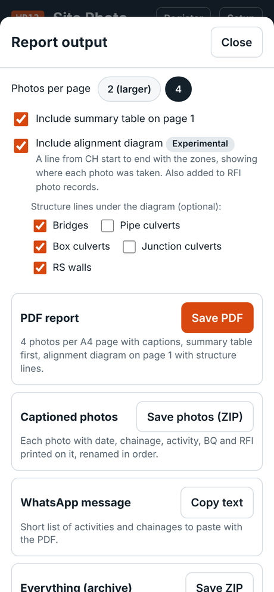
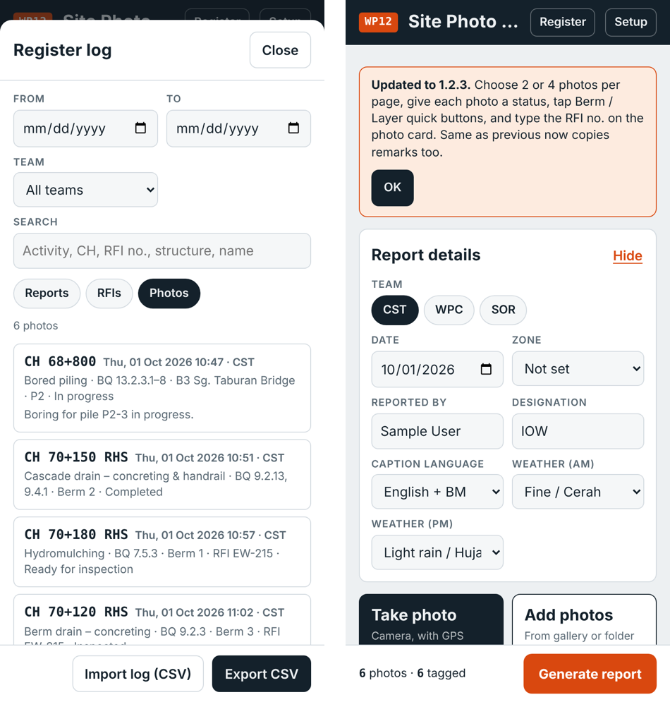

# WP12 Site Photo Report – User Guide

For app version 1.2.3. **Open the app:** [cstwp12-admin.github.io/wp12-sdr](https://cstwp12-admin.github.io/wp12-sdr/). The link is also under **About** on the [repository page](README.md), and pinned in the WP12 RFI coordination WhatsApp group.

**Contents:** [Quick guide](#quick-guide-the-3-daily-steps) · [1. Install](#1-install-the-app-and-set-up-once) · [2. Add photos](#2-add-photos) · [3. Tag each photo](#3-tag-each-photo) · [4. Generate and share](#4-generate-and-share-the-report) · [5. RFI photo record](#5-rfi-photo-record) · [6. Register and backup](#6-register-and-backup) · [7. RFI inspection list (WPC)](#7-rfi-inspection-list-wpc-experimental) · [8. Updates, feedback and common problems](#8-updates-feedback-and-common-problems)

## Quick guide: the 3 daily steps

A daily photo report takes three steps: add the photos, tag each one, then generate and share.

1. **Add photos.** Tap **Take photo** on site, or **Add photos** to pick them from the gallery afterwards.
2. **Tag each photo.** Choose the **activity**, check the **chainage** and **side**, then add the level (e.g. *Berm 3*), status and RFI no. where they apply. Every photo needs at least an activity and a chainage.
3. **Generate and share.** Tap **Generate report**, fix anything in *Check before you share*, then **Share PDF** to the WhatsApp group. Inspection photos also get an **RFI photo record**.

The app keeps your draft if the phone closes the browser. Start the next day with **New report** (the red button beside *Sort by chainage*; it clears the photos, so share or save the report first, and sets the report type back to Daily). If you hide *Report details*, its one-line summary shows a date that is not today in orange.

## 1. Install the app and set up once

The app runs in the phone's browser; there is nothing to download from an app store.

1. Open the app link on your phone.
2. Add it to the home screen:
   - **iPhone (Safari):** Share → *Add to Home Screen*.
   - **Android (Chrome):** menu ⋮ → *Install app* or *Add to home screen*.
   - **Laptop:** open the link in Chrome or Edge and bookmark it.
3. Open the app from the home-screen icon. The project setup (logos, zones, activity list, structures, centreline) loads by itself the first time you open it with signal.
4. In **Report details**, choose your **team** (CST, WPC or SOR) and type your **name** and **designation**. The app remembers them.
5. Choose the **caption language**: English, BM, or English + BM. Set the **weather** for the morning and afternoon.

Leave **Zone** as *Not set* unless all your photos are in one zone; the report then lists the zones from the photos' chainages.

### Your own zones (optional)

The app starts with the team's 4 zones. If your team reports by different zones, e.g. 5 zones for CST, set them in **Setup → Zones**:

1. Type each zone's name and its **From CH** and **To CH**.
2. **+ Add zone** adds a row; **×** removes one.
3. **Use team zones** goes back to the team's zones.

Your zones stay on your phone: a team setup update does not change them. They are used for the zone list in the report header, the zone tag on each photo card and the zone bands in the alignment diagram.

## 2. Add photos

Photos with a GPS position get their chainage and side filled in automatically from the WP12 centreline, so add the original camera photos whenever you can.

| Way to add | Chainage filled in? | Use it when |
| --- | --- | --- |
| **Take photo** (in the app) | Yes, from the phone's location | You are on site with the app open. Allow location when asked. |
| **Add photos**, original camera photos | Yes, if the camera saved the location | You took photos with the phone camera and tag them later. |
| **Add photos**, photos saved from WhatsApp | No: WhatsApp removes the location | Only when you have no original. Type the chainage yourself. |

JPG, PNG and **HEIC / HEIF** photos can be added. On Android and laptops a HEIC photo is converted on the phone; the converter downloads the first time it is needed, so do that once with signal. On iPhone you can also set the camera to *Most Compatible* (Settings → Camera → Formats) to take JPG photos.

Each photo card shows what was found: a green **GPS → CH 70+000 · 20 m RHS** tag, an orange tag when the position is more than 150 m from the road, or **No GPS in photo**. GPS is accurate to about 5–10 m, so the chainage is rounded to 5 m; check it against the site pegs where it matters.

Photos are sorted by the time taken. **Sort by chainage** puts them in order along the alignment instead (photos with no chainage go to the end); **Sort by time** puts them back. Use **↑ / ↓** on a card to move one photo, and **Remove** to delete one (you can undo it for a few seconds).

## 3. Tag each photo

Every photo needs an activity and a chainage; the other fields are optional and only print when filled in.

| Field | What to enter | Example |
| --- | --- | --- |
| **Activity** | Tap the activity box, search in English or BM, or by BQ item no. Tap each activity that applies (they get a tick), then **Done**. QC tests are marked *QC*. Not in the list? Type it under *Not in the list?* and tap **Add**. | *Berm drain – concreting* + *Cube test – G30* |
| **Structure** | Pick a bridge, culvert or wall. Its drawing chainage fills in; adjust it to the actual position. | *B3 Sg. Taburan Bridge* |
| **On the alignment / Elsewhere** | Leave *On the alignment* for work on the road. For a photo at the site laboratory, a third-party laboratory, a factory, a precast yard or another site, tap **Elsewhere** and type the place; the place is printed instead of a chainage and is remembered for next time. A photo taken more than 150 m from the road offers *Elsewhere*. | *Site laboratory WP12* |
| **Chainage** | Check the GPS chainage, or type it. For a stretch of work, tap **+ Chainage to** beside it and type the end chainage; **× Remove** takes the range off. | *70+120*, or *70+120* to *70+300* |
| **Side** | LHS, RHS, CL or Both. | *RHS* |
| **Element / point** | The box is named for the activity. *Sampling point* for water, air and noise monitoring, sampling and instrumentation: type the point, e.g. *W1* (printed *Sampling point W1*); the round, e.g. *Quarterly*, goes in Remarks. *Element* for bridges, culverts or a structure: *Abutment A*, *Pier 2*, *Base slab*. *Layer / level* for earthworks and pavement: *Layer 3*, *Berm 2*, *Subgrade*. In BM captions, *Layer* prints as *Lapisan*. | *W1*, *Pier 2*, *Layer 3* |
| **Status** | Choose one, or *Other…* to type your own. | *Inspected* |
| **Test result** | Shown for testing and sampling activities (QC tests, cube tests, FDT, sampling). Choose Passed, Failed, Retest required, Pending test result (inspected, result due in a few days), Pending official test result, or *Other…* to type your own. Prints with the status, e.g. *Inspected, Result: Pending test result*. | *Pending test result* |
| **Progress** | Optional estimate of how far the work is, in %: pick it in the box beside *Status* (10% steps, plus 25% and 75%). Prints with the status, e.g. *In progress, 50% complete*. Useful for work followed over several days, e.g. rebar fabrication or box culvert reinforcement. | *50* |
| **RFI no.** | Only for inspection photos. Type the trade code and number; the prefix *JKR-RFI-WP12-* is fixed. | *EW-215* |
| **Remarks** | Tap *Remarks* to open. | *Erosion at lower slope face* |

The statuses print in English and BM: In progress, Completed, Ready for inspection, Inspected, Re-inspection required, Rectification required, Observation.

### Save time when photos share the same tags

- **Same as previous** (on each card from photo 2): copies the activity, structure, level, status, RFI no. and remarks from the photo above. A photo with its own GPS chainage keeps it, so a series along the same work only needs checking.
- **Tag several photos at once:** tick **Select** on each photo, tap **Tag selected**, fill in only the fields to change, then **Apply**. Empty fields leave each photo as it is.
- **Remove several photos:** select them and tap **Remove** in the orange bar. **Undo** puts them back for a few seconds.

## 4. Generate and share the report

Tap **Generate report** at the bottom of the screen. The report screen opens with a check of your photos and the share buttons.

1. **Report ref. no.** The report gets a reference such as *WP12-WPC-SYA-20261012-1*: package, team, your initials (type them once in Report details), date and the report no. of the day on this phone. It is shown at the top of the report screen and can be changed there. It counts from this phone's register, so after clearing the phone's data, check the number of a second report on the same day.
1. **Check before you share.** The box lists photos with no activity or no location (chainage or place). Tap a photo number to go straight to that photo, fix it, then tap **Generate report** again. You can still generate the report with gaps.
2. **Photos per page.** Choose **4** (the usual daily report) or **2 (larger)** when detail matters, e.g. rebar or a defect. The phone remembers your choice.
3. **Summary table.** Leave *Include summary table on page 1* ticked for a list of all photos on the first page.
4. **Alignment diagram (experimental).** Tick *Include alignment diagram* to add a line from CH 62+700 to 77+508 with the zones, showing where each photo was taken (see below). You can also tick structure lines to show under it. The phone remembers your choices.
5. **Share.** Each button makes its file the first time and reuses it after:
   - **Share PDF**: the report. Pick WhatsApp, then the group.
   - **Share photos**: each photo with its caption printed on it, renamed in order.
   - **Copy text**: a short list of activities and chainages to paste with the PDF.
   - **Save ZIP**: the PDF, captioned photos, RFI photo records and a CSV photo log, for your own files.

On a laptop, the share buttons save the files instead; send them from WhatsApp Web or Desktop.

### Period report: a week or a month (experimental)

For a weekly or monthly report, set **Report type** to *Period* in Report details. Keep adding photos day by day (do not start a New report in between); each photo keeps its own date. *From* and *To* fill in from the photos and can be changed. **Generate report** then makes:

- a **progress table** for the period: each activity and place, the photo numbers, the days photographed, and the latest status and progress %;
- the **photos day by day**, each day starting on a new page with its date;
- a WhatsApp text grouped by day, and a ref. no. ending with *P* and the last date, e.g. *WP12-CST-SYA-P20261018-1*.

**Photos with no camera date.** Each photo goes under the day it was taken, read from the camera data. Photos saved from WhatsApp or sent by others have lost it: the app then takes the date from the file name if it has one (e.g. *IMG-20261010-WA0012.jpg*), otherwise the file's date, which may be the day it was saved. These cards show a **Date taken** box in orange: check the date and change it if needed, or select several and use **Tag selected → Date taken**. *Check before you share* lists photos whose date is not confirmed, or outside the period. Photos taken with **Take photo** in the app or added as original camera photos need no check.

The photos stay on this phone until you start a New report, so keep the app on the Home Screen and **Save ZIP** at least once a week. The ZIP also holds a *report_data.json* file, which a later version will use to put several people's reports together.

### Logos for each team

**Setup → Report logos**: pick the team (CST, WPC or SOR), then for the left and right logo choose an image, type a text (e.g. *CST*), or tap *None*. For example JKR + WPC for WPC reports and JKR + CST for CST internal reports. Without a team logo, the logo from the team setup is used. The logos stay on this phone; *Save setup file* passes them on.

### Alignment diagram (experimental)

The diagram shows where the day's photos were taken along the whole alignment. Each marker carries the photo number:

- **above the line:** LHS · **on the line:** CL, or no side chosen · **below the line:** RHS · **Both:** above and below;
- **a short bar** along the line: a photo with *Chainage to* (a stretch of work);
- **one marker for several photos** (e.g. *2–5*) when they are within about 500 m of each other: at this scale they cannot be shown apart. Each photo's caption still gives its exact chainage;
- a line under the diagram gives the chainage range covered, e.g. *Photos from CH 68+800 to 70+180 (Zone 2, Zone 3)*;
- photos with no chainage, or more than 150 m from the road by GPS, are left out, and a note under the diagram says how many.

**Structure lines.** Under *Include alignment diagram*, tick the structures to show: **Bridges**, **Pipe culverts**, **Box culverts**, **Junction culverts** and **RS walls**. Each one you tick gets its own line under the diagram, with a tick and the structure no. (e.g. *B3*, *C19*, *JC5*, *RSW1*) at its drawing chainage, and a faint guide up to the alignment. Where structures are too close for every label, some numbers are left out but every tick is drawn. All are off at first; the phone remembers your choice.

Structure positions are indicative (drawing chainages). The diagram is experimental: tell us at the pilot review whether it is useful, which structure lines you use, and whether a zoomed view of the day's chainages should be added.

Saving or sharing a report also logs it in the **Register** (section 6).

## 5. RFI photo record

The RFI photo record is a PDF attachment to the JKR Sabah RFI form (Arahan Jabatan Bil. 11/2026): one record per RFI no. It shows what the photos show; the drawing reference, stage and inspection result stay on the signed RFI form, which remains the record of inspection.

Page 1 has:

- **details:** location (zone, chainage range, side), description of works, activities with their BQ / QC refs, structure and level, and the number of photos;
- **photo index:** one line per photo with its no., time, activity, location, level and status;
- the **alignment diagram**, if ticked (when it is too tall to fit with the sign-off, it moves to the top of the first photo page);
- **comments**, and sign-off blocks for **Prepared by (WPC)** and **Checked by (CST)**.

The photos follow from page 2.

1. **Tag the inspection photos with the RFI no.** On each photo card, type the trade code and number in **RFI no.**, e.g. *EW-215*. Several photos can share one RFI no.
2. **Tap Generate report.** When any photo has an RFI no., the report screen shows **RFI photo records** near the top. Tap **Make RFI photo records**.
3. **Open the RFI.** Each RFI no. has its own panel, with the location and description taken from its photos.
4. **Fill in two things if needed:**
   - **Description of works:** leave it to use the activities, or type the RFI form's wording.
   - **Comments:** optional.
5. **Check each photo's status** on the photo cards (e.g. *Ready for inspection*, *Inspected*, *Re-inspection required*); it is printed in the photo index.
6. **Share or save the record** and attach it to the RFI form.
7. **Sign on paper:** **Prepared by (WPC)** and **Checked by (CST)**.

The photos in the record follow the **Photos per page** choice (2 or 4); for a close inspection, 2 per page shows more detail. When *Include alignment diagram* is ticked, page 1 of the record also shows where that RFI's photos are on the alignment.

## 6. Register and backup

Every report you save or share is logged in the **Register** on your phone, so you can find past photos and RFIs without scrolling through WhatsApp.

- **Views:** *Reports* (one line per daily report), *RFIs* (one line per RFI photo record, with the status of its photos) and *Photos* (one line per photo, with activity, BQ ref, level, RFI no. and status).
- **Filters:** date from and to, team, and a search box for activity, chainage, RFI no., structure or name.
- **Export CSV:** saves the current view as a CSV file that opens in Excel.
- **Import log (CSV):** adds another person's records. Use the `photo_log.csv` inside their ZIP.

**Back up the register.** It lives only in this phone's browser; clearing the browser data deletes it. The app asks the browser to keep its data, and if you have not exported the register for 7 days it shows a reminder: tap **Export now** to save the full photo log, or **Later** to be reminded the next day. Keep the exported CSV with your project files.

A team that wants one shared register can connect the app to its own Google Sheet (Setup → *Team register*); the steps are in [TEAM_REGISTER.md](TEAM_REGISTER.md). It is optional and not needed for the pilot.

## 7. RFI inspection list (WPC, experimental)

The daily RFI summary list that WPC posts for the next day's inspections can be made in the app and shared as a PDF, in the same layout as the Excel list: No., RFI reference no., issued date, inspection date, description, location, PIC and time of inspection. It is an extra, not part of the photo report, and is marked *Experimental*: tell us at the pilot review whether it is practical.

The **RFI inspection list** button is on the main screen, under Report details, when the team is **WPC**. Other teams can switch it on in Setup → *Experimental features*.

1. **Set the dates.** The *Inspection date* starts as tomorrow and the *Issued date* as today; change them if needed. Check **Prepared by** under the dates: the name, team and language come from Report details (tap **Change in Report details** to change them).
2. **Add the RFIs**, in either way:
   - **Paste from Excel:** in your Excel list, select the rows, with the heading row if you can, and copy. Tap **Paste from Excel**, paste in the box and check the table: the app matches the columns by their headings. A second line under a row (e.g. *Casting location*) is joined to the row above. A location written as a chainage, e.g. *Zone 4: CH76+500 - CH77+075 LHS*, goes into the Chainage, Chainage to and Side boxes, and the zone is added from the app's zones; any other place, e.g. *Site Laboratory WP12*, stays as the other location. Tap **Add**. Pasting an RFI that is already in the list updates it.
   - **+ Add RFI:** type the RFI no. (the prefix *JKR-RFI-WP12-* is fixed), and optionally choose the activity from the same list as the photo cards: it fills in the description, which you can change. Add the location as a chainage (with *Chainage to* and the side), a structure, or another place such as *Site Laboratory WP12*, then the PIC and the time. **Save and add another** keeps the form open for the next RFI.
3. **Check the list.** Use **Edit**, **↑ / ↓** and **×** on each row (× can be undone for a few seconds). **Sort: by time** puts the rows in order of inspection time, and **by RFI no. (trade)** groups them by trade code (ETR, PAV, TES…), then number. A row with no RFI no., time or description is marked.
4. **Share:**
   - **Share PDF** (A4 landscape);
   - **Copy text**: a short list to paste in the WhatsApp group;
   - **Save CSV (Excel)**: the same list as a CSV file.
5. **Next day:** tap **New list**. The last list is kept under **Earlier lists**, where each list can be opened again or deleted. **Clear list** removes all the RFIs from the list on screen (tap it twice; it can be undone).

**On the inspection day**, the list helps with the photos: typing an RFI no. on a photo card suggests the RFIs in the list. When the photo has no activity, structure or chainage yet, it takes them from the list (check them against the photo). The RFI photo record uses the list's description unless you type another one.

## 8. Updates, feedback and common problems

**Updates** arrive by themselves: open the app with signal and it loads the newest version. After an update, a short notice on the main screen says what changed; tap **See what changed** for the full list, then **OK**. The version number is at the bottom of **Setup**, and Setup → **What changed** opens the list of changes ([CHANGELOG.md](CHANGELOG.md)) at any time.

**Feedback:** Setup → **Send feedback on WhatsApp** opens a message with the app version and your phone type already filled in. Add what you tried to do, what happened and a screenshot, then post it in the WP12 RFI coordination group.

| Problem | What to do |
| --- | --- |
| No chainage filled in | The photo has no location: it was saved from WhatsApp, or location was off. Type the chainage, or add the original camera photo. On the phone, allow location for the camera and the browser. |
| Orange tag: GPS outside WP12 | The position is more than 150 m from the road. Check the photo and type the chainage. |
| The activity is not in the list | Search in English, BM or by BQ no. first. Still missing: type it under *Not in the list?*, tap **Add**, and report it so it can be added for everyone. |
| Share opens nothing, or saves a file | Some browsers and laptops cannot share files. Save the file, then send it from WhatsApp. On iPhone use Safari; on Android use Chrome. |
| Setup still shows the old version | Open the app with signal, close it fully and open it again. |
| Logos or activity list missing | Open the app with signal so the project setup loads. |
| Photos or register gone | Browser data was cleared. Drafts and the register cannot be recovered; this is why the register should be exported regularly (section 6). |

---

The pilot and rollout plan is in [ROADMAP.md](ROADMAP.md).
