# WP12 Site Photo Report – User Guide

For app version 1.2.6. **Open the app:** [cstwp12-admin.github.io/wp12-sdr](https://cstwp12-admin.github.io/wp12-sdr/). The link is also under **About** on the [repository page](README.md), pinned in the WP12 RFI coordination WhatsApp group, and as a QR code in Setup → **Share this app**.

Photos and logos in the screenshots are blurred.

**Contents:** [Quick guide](#quick-guide-the-3-daily-steps) · [Quick post](#quick-post-snap-caption-send) · [1. Install](#1-install-the-app-and-set-up-once) · [2. Add photos](#2-add-photos) · [3. Tag each photo](#3-tag-each-photo) · [4. Generate and share](#4-generate-and-share-the-report) · [5. Drawings and references](#5-drawings-and-references-step-by-step-experimental) · [6. RFI photo record](#6-rfi-photo-record) · [7. Register and backup](#7-register-and-backup) · [8. RFI inspection list, request tickets and Today's RFIs](#8-rfi-inspection-list-request-tickets-and-todays-rfis-experimental) · [9. QR codes: scan and share](#9-qr-codes-scan-and-share) · [10. Experimental features](#10-experimental-features) · [11. Updates, feedback and common problems](#11-updates-feedback-and-common-problems)

## Quick guide: the 3 daily steps

A daily photo report takes three steps: add the photos, tag each one, then generate and share.

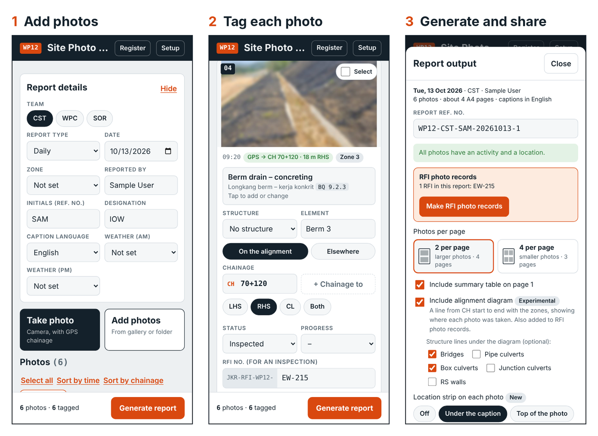

1. **Add photos.** Tap **Take photo** on site, or **Add photos** to pick them from the gallery afterwards.
2. **Tag each photo.** Choose the **activity**, check the **chainage** and **side**, then add the element or level (e.g. *Berm 3*), status and RFI no. where they apply. Every photo needs at least an activity and a chainage (or a place, for photos away from the road).
3. **Generate and share.** Tap **Generate report**, fix anything in *Check before you share*, then **Share PDF** to the WhatsApp group. Inspection photos also get an **RFI photo record**.

The app keeps your draft if the phone closes the browser. Start the next report with **New report** (the red button beside *Sort by chainage*; tap it twice). It clears the photos, so share or save the report first; it sets the report type back to Daily and gives the next report no.

**Good habits that make the report more useful:**

- Use the phone camera's original photos (or **Take photo**), not photos saved from WhatsApp: the GPS chainage then fills in by itself.
- Fill in the **status** on every photo, and the **test result** on testing photos. The reader then knows what the photo shows without asking.
- Put the **RFI no.** on inspection photos and attach the **drawing reference** they were checked against (section 5).
- Check *Check before you share* and the **Preview** before sending.
- One report a day is simplest. Several reports a day (e.g. one for bored piling, one for safety observations) are fine: each gets its own no.

## Quick post: snap, caption, send

For a photo you want in the WhatsApp group straight away, instead of the phone camera and a typed message.

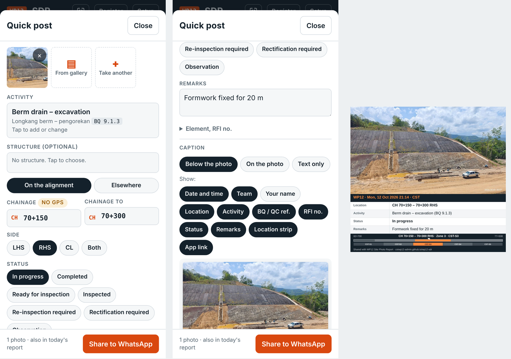

1. Tap **Quick post** (the orange button at the top). It opens and waits: tap **Gallery** to pick the photos you took with the phone's own camera app (their GPS and time are kept), or **Take photo** / **Take another** for the camera inside the app. **Settings ›** (top of the sheet) goes to Setup → *Photos and Quick post*, where Quick post can open the gallery or the camera by itself.
2. **Tag it on one screen:** the **activity** and the **structure** are chosen in a drawer (tap the box; the structure drawer has a search and *Other* to type your own). The **status** also has *Other…* to type your own. Then the location: **On the alignment** (the **chainage** comes from GPS, type it if needed; tap **+ Chainage to** for a stretch, and **× Remove** to take it away; the **side**) or **Elsewhere** with a place, e.g. *Site laboratory* or *Site office*. Then the **status** and any **remarks**. *Element, RFI no.* is under the last line.
3. **Caption:** **Below the photo** (the default: the photo is not covered, the caption is a table under it), **On the photo**, or **Text only** (the photo as taken, the caption as the WhatsApp message). Under *Show*, tap the parts to leave out, e.g. *BQ / QC ref.* or *Location strip*. The preview shows the result.
4. Tap **Share to WhatsApp**, pick the group and send.

The photos also go into today's report, with their tags, so the evening PDF report is mostly done. The caption choices are remembered.

**Photos taken in the app and the phone's gallery.** A web app cannot put a photo in the camera roll by itself. So the app keeps the camera original of every photo taken inside it and offers **Save to phone** (Android: the file goes to Downloads; iPhone: the share menu opens, choose *Save Image*). By default a copy is saved at once (Android); Setup → *Photos and Quick post* can ask each time or stop. The originals stay in the app until you start a New report, and **Save ZIP** (report screen) can include them in an *original_photos* folder. If WhatsApp does not show the message text with the photo (some iPhones), paste it: the app copies it for you.

## 1. Install the app and set up once

The app runs in the phone's browser; there is nothing to download from an app store.

1. Open the app link on your phone, or scan the QR code on a colleague's phone (Setup → **Share this app**).
2. Add it to the home screen:
   - **iPhone (Safari):** Share → *Add to Home Screen*.
   - **Android (Chrome):** menu ⋮ → *Install app* or *Add to home screen*.
   - **Laptop:** open the link in Chrome or Edge and bookmark it.
3. Open the app from the home-screen icon. The project setup (logos, zones, activity list, structures, centreline) loads by itself the first time you open it with signal.
4. In **Report details**, choose your **team** (CST, WPC or SOR) and type your **name**, **designation** and **initials** (used in the report ref. no., e.g. *SAM*). The app remembers them.
5. Choose the **caption language**: English, BM, or English + BM. Set the **weather** for the morning and afternoon.

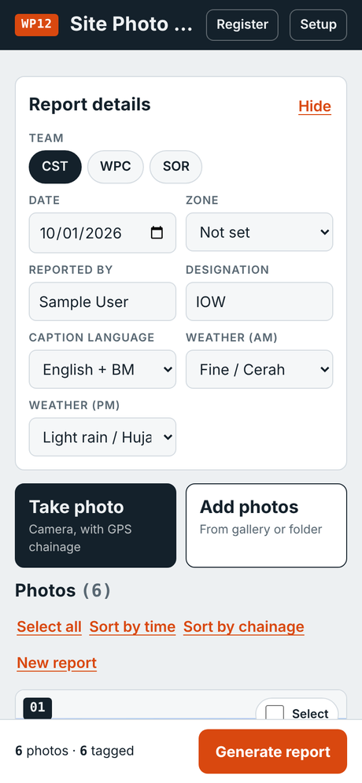

Leave **Zone** as *Not set* unless all your photos are in one zone; the report then lists the zones from the photos' chainages.

### Logos for each team

The logos come with the team setup: team CST gets JKR and the CST logo, WPC and SOR get JKR and the WPC logo. To change them, **Setup → Report logos**: pick the team, then for the left and right logo choose an image, type a text (e.g. *CST*), or tap *None*. A logo chosen on the phone comes first; *Use setup logo* goes back to the team setup's.

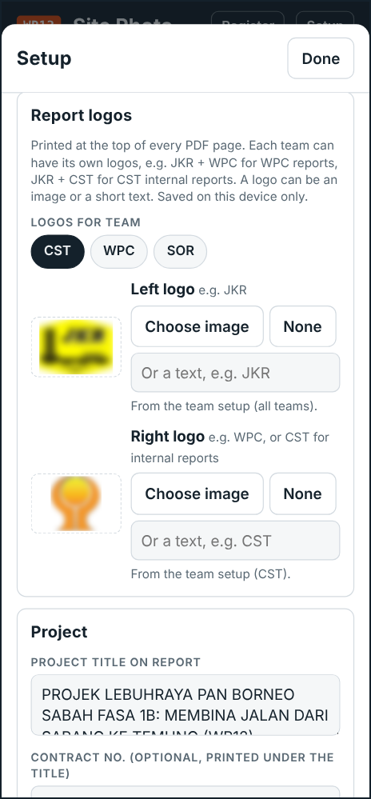

### Your own zones (optional)

The app starts with the team's 4 zones. If your team reports by different zones, e.g. 5 zones for CST, set them in **Setup → Zones**:

1. Type each zone's name and its **From CH** and **To CH**.
2. **+ Add zone** adds a row; **×** removes one.
3. **Use team zones** goes back to the team's zones.

Your zones stay on your phone: a team setup update does not change them. They are used for the zone list in the report header, the zone tag on each photo card, the zone bands in the alignment diagram and the location strip.

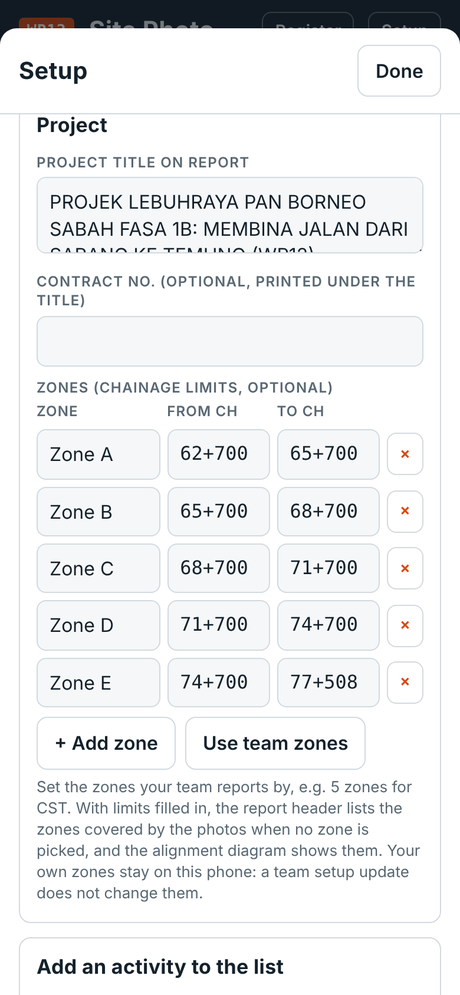

## 2. Add photos

Photos with a GPS position get their chainage and side filled in automatically from the WP12 centreline, so add the original camera photos whenever you can.

| Way to add | Chainage filled in? | Use it when |
| --- | --- | --- |
| **Take photo** (in the app) | Yes, from the phone's location | You are on site with the app open. Allow location when asked. |
| **Add photos**, original camera photos | Yes, if the camera saved the location | You took photos with the phone camera and tag them later. |
| **Add photos**, photos saved from WhatsApp | No: WhatsApp removes the location | Only when you have no original. Type the chainage yourself. |

JPG, PNG and **HEIC / HEIF** photos can be added. On Android and laptops a HEIC photo is converted on the phone; the converter downloads the first time it is needed, so do that once with signal. On iPhone you can also set the camera to *Most Compatible* (Settings → Camera → Formats) to take JPG photos.

Each photo card shows what was found: a green **GPS → CH 70+120 · 18 m RHS** tag, an orange tag when the position is more than 150 m from the road, or **No GPS in photo**. GPS is accurate to about 5–10 m, so the chainage is rounded to 5 m; check it against the site pegs where it matters.

**Date taken.** A photo saved from WhatsApp has lost its camera date. The app then takes the date from the file name if it has one (e.g. *IMG-20261010-WA0012.jpg*), otherwise the file's date, and shows a **Date taken** box in orange on the card: check it and change it if needed.

**The same photo twice.** Adding a photo that is already in the report (same file and time taken) is skipped, with a note at the bottom of the screen.

Photos are sorted by the time taken. **Sort by chainage** puts them in order along the alignment instead (photos with no chainage go to the end); **Sort by time** puts them back. Use **↑ / ↓** on a card to move one photo, and **Remove** to delete one (you can undo it for a few seconds).

## 3. Tag each photo

Every photo needs an activity and a location; the other fields are optional and only print when filled in.

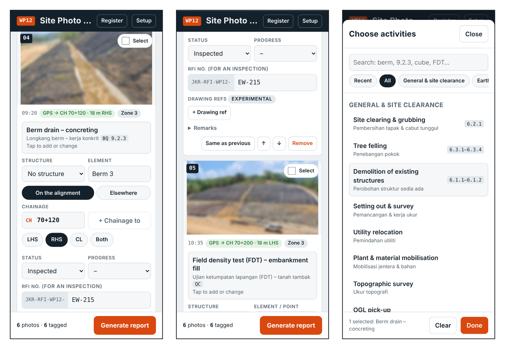

| Field | What to enter | Example |
| --- | --- | --- |
| **Activity** | Tap the activity box, search in English or BM, or by BQ item no. Tap each activity that applies (they get a tick), then **Done**. QC tests are marked *QC*. Not in the list? Type it under *Not in the list?* and tap **Add**. | *Berm drain – concreting* + *Cube test – G30* |
| **Structure** | Pick a bridge, culvert or wall. Its drawing chainage fills in; adjust it to the actual position. | *B3 Sg. Taburan Bridge* |
| **On the alignment / Elsewhere** | Leave *On the alignment* for work on the road. For a photo at the site laboratory, a third-party laboratory, a factory, a precast yard or another site, tap **Elsewhere** and type the place; the place is printed instead of a chainage and is remembered for next time. | *Site laboratory WP12* |
| **Chainage** | Check the GPS chainage, or type it. For a stretch of work, tap **+ Chainage to** and type the end chainage; **× Remove** takes the range off. | *70+120*, or *70+120* to *70+300* |
| **Side** | LHS, RHS, CL or Both. | *RHS* |
| **Element / point** | The box is named for the activity. *Sampling point* for water, air and noise monitoring: type the point, e.g. *W1*. *Element* for bridges, culverts or a structure: *Abutment A*, *Pier 2*, *Base slab*. *Layer / level* for earthworks and pavement: *Layer 3*, *Berm 2*, *Subgrade*. | *W1*, *P2*, *Layer 3* |
| **Status** | Choose one, or *Other…* to type your own. | *Inspected* |
| **Test result** | Shown for testing and sampling activities. Passed, Failed, Retest required, Pending test result, Pending official test result, or *Other…*. Prints with the status, e.g. *Inspected, Result: Pending test result*. | *Pending test result* |
| **Progress** | Optional estimate in %, beside *Status*. Prints with the status, e.g. *In progress, 60% complete*. | *60* |
| **RFI no.** | Only for inspection photos. Type the trade code and number; the prefix *JKR-RFI-WP12-* is fixed. | *EW-215* |
| **Drawing refs** (experimental) | The drawing the work was checked against. See section 5. | *D1 WD/JKR/WP12/CS/DR/PNP/002* |
| **Remarks** | Tap *Remarks* to open. | *Boring for pile P2-3* |

The statuses print in English and BM: In progress, Completed, Ready for inspection, Inspected, Re-inspection required, Rectification required, Observation.

### Save time when photos share the same tags

- **Same as previous** (on each card from photo 2): copies the activity, structure, element, status, RFI no. and remarks from the photo above. A photo with its own GPS chainage keeps it.
- **Tag several photos at once:** tick **Select** on each photo, tap **Tag selected**, fill in only the fields to change, then **Apply**. Empty fields leave each photo as it is. Drawings and the date taken can be set this way too.
- **Remove several photos:** select them and tap **Remove** in the orange bar. **Undo** puts them back for a few seconds.

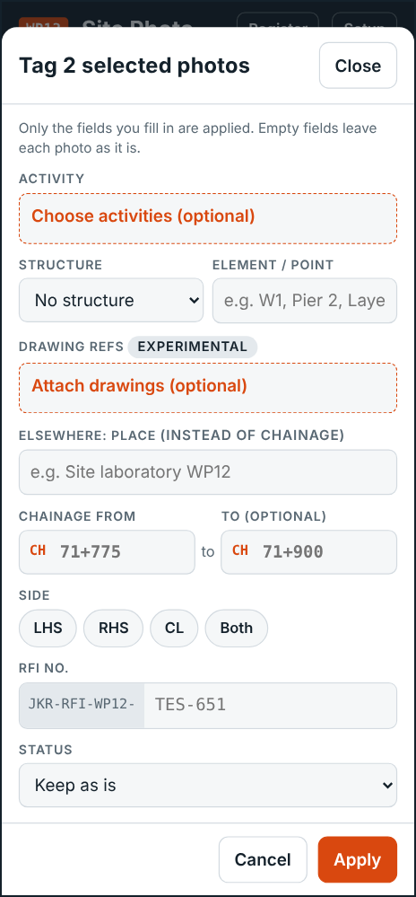

## 4. Generate and share the report

Tap **Generate report** at the bottom of the screen. The report screen opens with a check of your photos, the choices for the PDF and the share buttons.

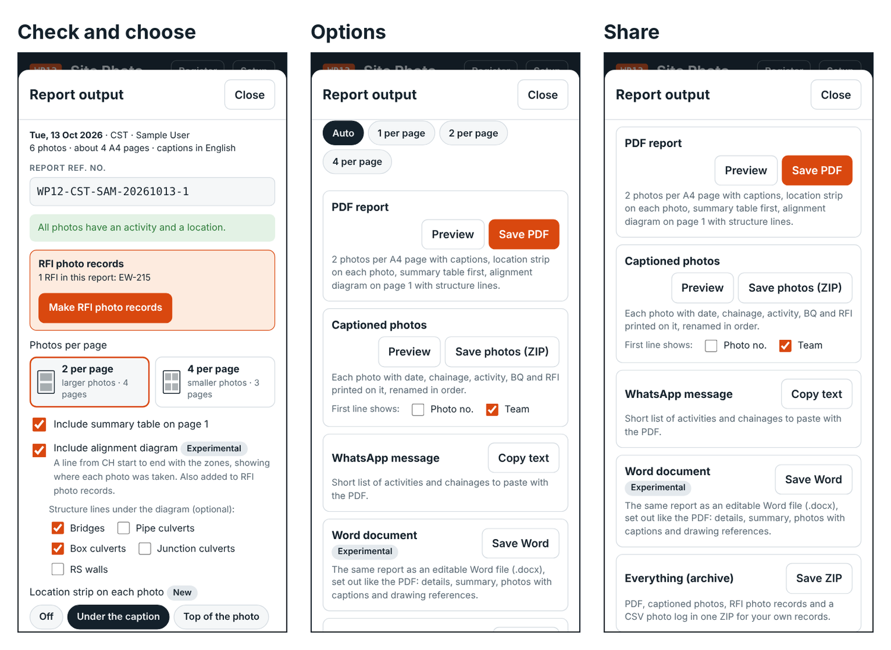

1. **Report ref. no.** The report gets a reference such as *WP12-CST-SAM-20261013-1*: package, team, your initials, date and the report no. of the day on this phone. It can be changed in the box. Each report has its own no.:
   - a no. counts as used once it is shown here, so **New report** always gives the next one (-2, -3 …), even if the last draft was never sent;
   - if you change the photos of a report that was already shared or saved, the next one becomes a new report with the next no.;
   - changing captions or details keeps the same no.;
   - the count is kept on this phone, so after clearing the phone's data, check the no. of a second report on the same day.
2. **Check before you share.** The box lists photos with no activity or no location. Tap a photo number to go straight to that photo, fix it, then tap **Generate report** again.
3. **Photos per page.** **2 per page** (the default) gives larger, clearer photos; **4 per page** gives a shorter report. Each choice shows how many pages it makes.
4. **Summary table.** Leave *Include summary table on page 1* ticked for a list of all photos on the first page.
5. **Alignment diagram (experimental).** Tick *Include alignment diagram* to add a line of the whole alignment on page 1 (see below), with optional structure lines under it.
6. **Location strip on each photo.** *Under the caption* (the default), *Top of the photo* or *Off*. For team CST a second line under it shows the **CST sections** (CST-S1 to CST-S5, one IOW each) as a thin blue-grey line, apart from the project's zone bar above it, with the photo's section highlighted; a photo at a structure is also tagged *CST structures*. Setup → *Project* switches the sections line on or off, and lets you change the sections (names, from and to chainages, and the tag for photos at a structure); **Use project sections** goes back to the project's. Each photo gets a small line of the whole alignment, with its zone shaded and a marker at its chainage, e.g. *CH 70+120 RHS · Zone 3*, in the PDF and on the captioned photos. Photos marked *Elsewhere* show their place instead.
7. **Drawing pages** (when photos have drawing refs): *Auto*, *1 per page*, *2 per page* or *4 per page* (section 5).

The phone remembers these choices.

### Share

Each button makes its file the first time and reuses it after:

- **Preview** (beside the PDF button): the pages in the app before sending them. **Share PDF** at the bottom of the preview sends the same file. (The preview downloads its PDF viewer the first time, so do it once with signal.)
- **Share PDF**: the report. Pick WhatsApp, then the group. Once made, its size shows in the PDF row.
- **Captioned photos**: each photo with its caption, renamed in order. **Preview** shows them first. *Caption*: **On the photo** (as before) or **Below the photo** (the photo whole, the caption as a table under it). *Show*: tap the parts to leave out or add, e.g. the **photo no.** (off by default), the **team**, **your name**, the BQ / QC ref. or the location strip. The same choices apply to Quick post.
- **Copy text**: a short list of activities and chainages to paste with the PDF.
- **Save Word** (experimental): the same report as an editable Word file (.docx), set out like the PDF, saved to the phone (Downloads, or Files on iPhone). Open it in Word or WPS, edit, then send it from there. **Share Word** opens the share menu instead. If nothing appears, tap **Save again** in the bar at the bottom.
- **Save ZIP**: the PDF, captioned photos, RFI photo records and a CSV photo log, for your own files.

If a PDF takes a few seconds to make, the phone may not open the share menu straight away. The bar at the bottom then says *… is ready*: tap **Share** on it. On a laptop the share buttons save the files instead; send them from WhatsApp Web or Desktop.

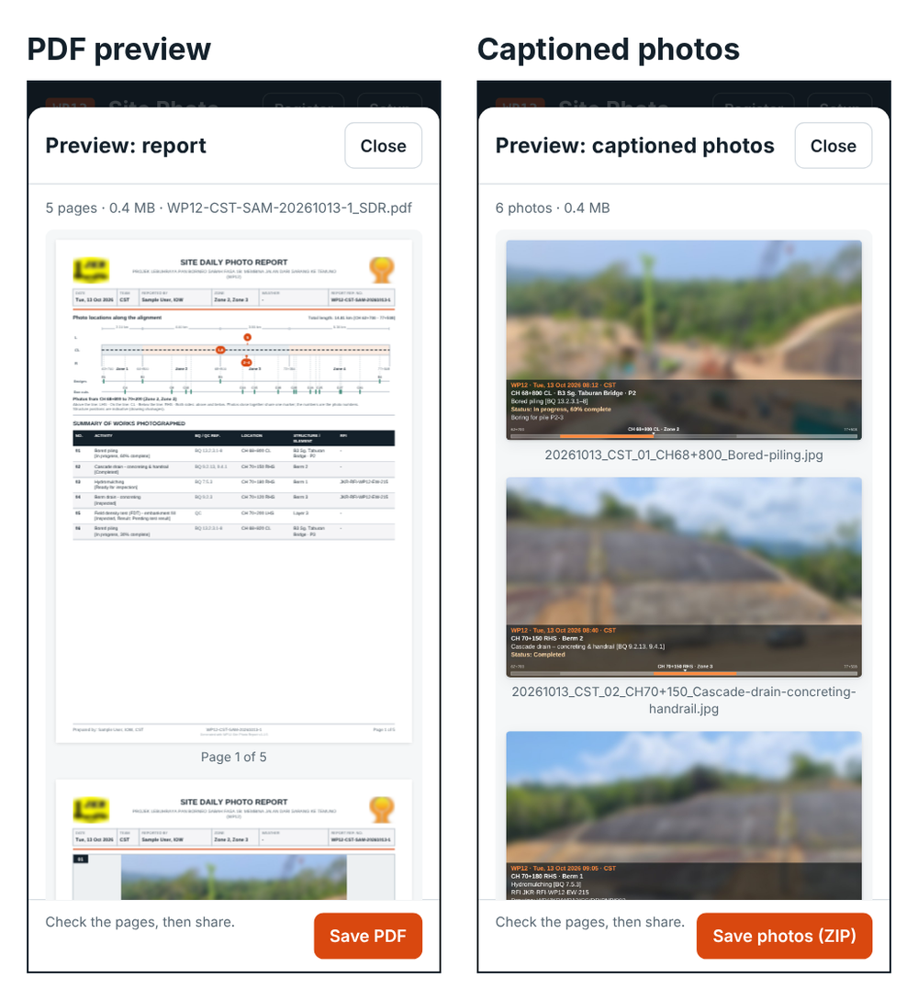

The PDF report: details and summary on page 1, then the photos with their captions and location strips. The footer of page 1 has two small QR codes in its corners:

- **Scan for the app** (bottom right): anyone scans it with the phone camera to open the app;
- **Report record** (bottom left; **off by default**, switch it on in Setup): another phone with the app scans it to add the report to its Register (section 9).

Both can be switched off or on in Setup → *Share this app*.

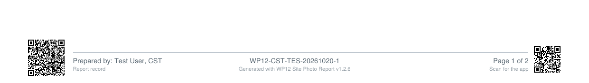

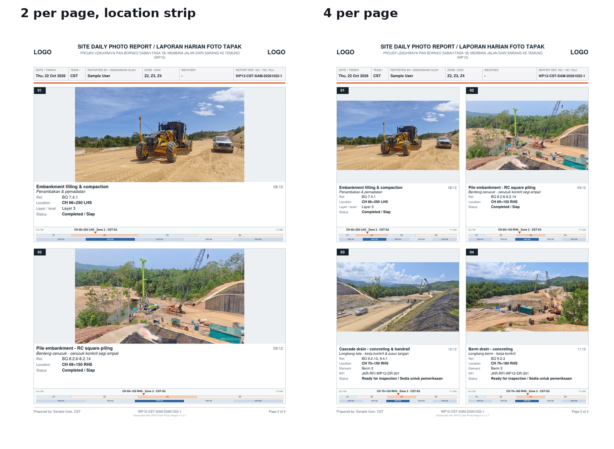

### Alignment diagram (experimental)

The diagram shows where the day's photos were taken along the whole alignment. Each marker carries the photo number:

- **above the line:** LHS · **on the line:** CL, or no side chosen · **below the line:** RHS · **Both:** above and below;
- **a short bar** along the line: a photo with *Chainage to*;
- **one marker for several photos** (e.g. *2–4*) when they are close together. Each photo's caption still gives its exact chainage;
- above the line, the length of each zone, and on the right the total length (14.81 km, CH 62+700 to 77+508);
- a line under the diagram gives the chainage range covered, e.g. *Photos from CH 68+800 to 70+200 (Zone 2, Zone 3)*;
- photos with no chainage, or more than 150 m from the road by GPS, are left out, and a note says how many.

**Structure lines.** Under *Include alignment diagram*, tick **Bridges**, **Pipe culverts**, **Box culverts**, **Junction culverts** and **RS walls** to show each on its own line, with the structure no. at its drawing chainage. Structure positions are indicative.

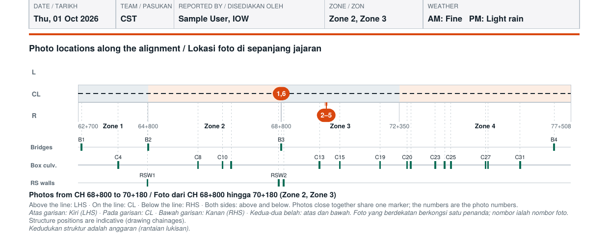

### Period report: a week or a month (experimental)

For a weekly or monthly report, set **Report type** to *Period* in Report details. Keep adding photos day by day (do not start a New report in between); each photo keeps its own date. *From* and *To* fill in from the photos and can be changed. **Generate report** then makes:

- a **progress table** for the period: each activity and place, the photo numbers, the days photographed, and the latest status and progress %;
- the **photos day by day**, each day starting on a new page with its date;
- a WhatsApp text grouped by day, and a ref. no. ending with *P* and the last date, e.g. *WP12-CST-SAM-P20261018-1*.

Photos with no camera date show a **Date taken** box in orange (section 2); *Check before you share* lists photos whose date is not confirmed or outside the period. The photos stay on this phone until you start a New report, so keep the app on the Home Screen and **Save ZIP** at least once a week.

Saving or sharing a report also logs it in the **Register** (section 7).

## 5. Drawings and references: step by step (experimental)

Attach the part of a drawing that a photo refers to, e.g. the drainage plan for a berm drain, or the culvert detail for a box culvert pour. In the RFI photo record this shows the drawing the work was inspected against, next to the photos, so the record attached to the RFI form is complete.

Add a drawing once; it stays in the drawing library on your phone and can be attached to photos on any day.

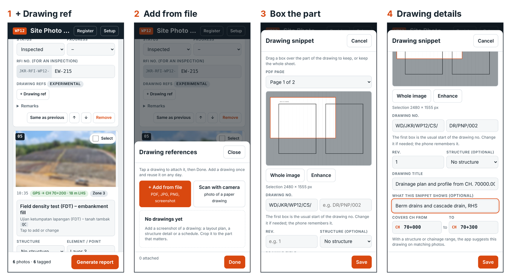

1. **On the photo card, tap + Drawing ref** (under the RFI no.).
2. **Tap + Add from file** and pick the drawing: a **PDF** (the PDF viewer downloads the first time, so do this once with signal), or an image (JPG, PNG, HEIC or a screenshot). For a paper drawing, tap **Scan with camera** instead (see below).
3. **Box the part to keep.** For a PDF with several pages, choose the **PDF page** first. To see the detail, **pinch** with two fingers or tap **+**; turn **Move** on to drag around the zoomed sheet, then off again to draw the box. **Fit** shows the whole sheet again. Drag a box over the part that matters, or tap **Whole image** to keep the whole sheet. **Enhance** gives a clean white background.
4. **Fill in the drawing details, then tap Save:**
   - **Drawing no.:** the usual start *WD/JKR/WP12/CS/* is already in the first box, so type only the rest, e.g. *DR/PNP/002*. Tap a recent trade (e.g. *DR/PNP/…*) to start it. If a drawing has another start, change the first box; the phone remembers it;
   - **Rev.** and **drawing title**;
   - **What this snippet shows**, e.g. *Berm drains and cascade drain, RHS*;
   - optionally the **structure** (e.g. *C19*) and the **chainage range** it covers. A title such as *… FROM CH. 70000.000 TO CH. 70300.000* fills the range in for you.

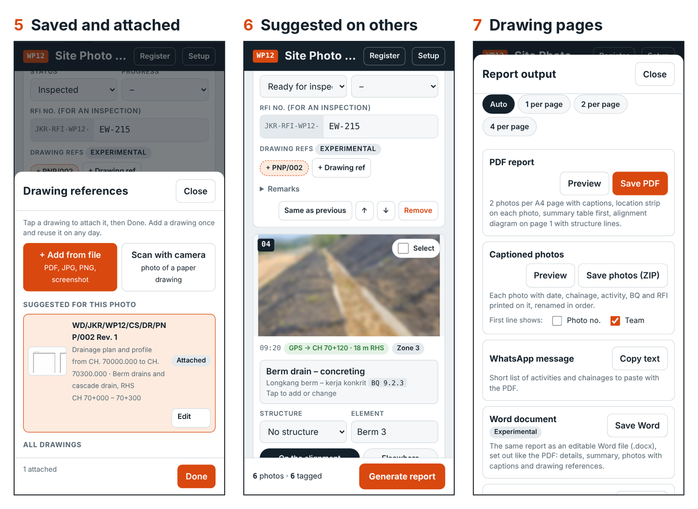

5. **It is attached** to the photo you started from (*Attached*), and listed in the library. Tap **Done**.
6. **On other photos**, a photo at the same structure, or with a chainage in the drawing's range, shows the drawing as a suggestion (e.g. *+ PNP/002*): one tap attaches it. Otherwise tap **+ Drawing ref** and pick it from the library. **Tag selected** attaches drawings to several photos at once.
7. **On the report screen**, choose **Drawing pages**: *Auto* (a wide snippet such as a plan takes the full width; two upright snippets such as sections share a row), *1 per page* (each drawing fitted to its own page; a wide drawing gets a landscape page), *2 per page* or *4 per page*.

**Scan a paper drawing.** Tap **Scan with camera** and take a photo of the sheet. Drag the 4 orange corners onto the corners of the sheet (or of the part you need), tap **Straighten**, then **Enhance**. An A-size sheet is set to its exact shape.

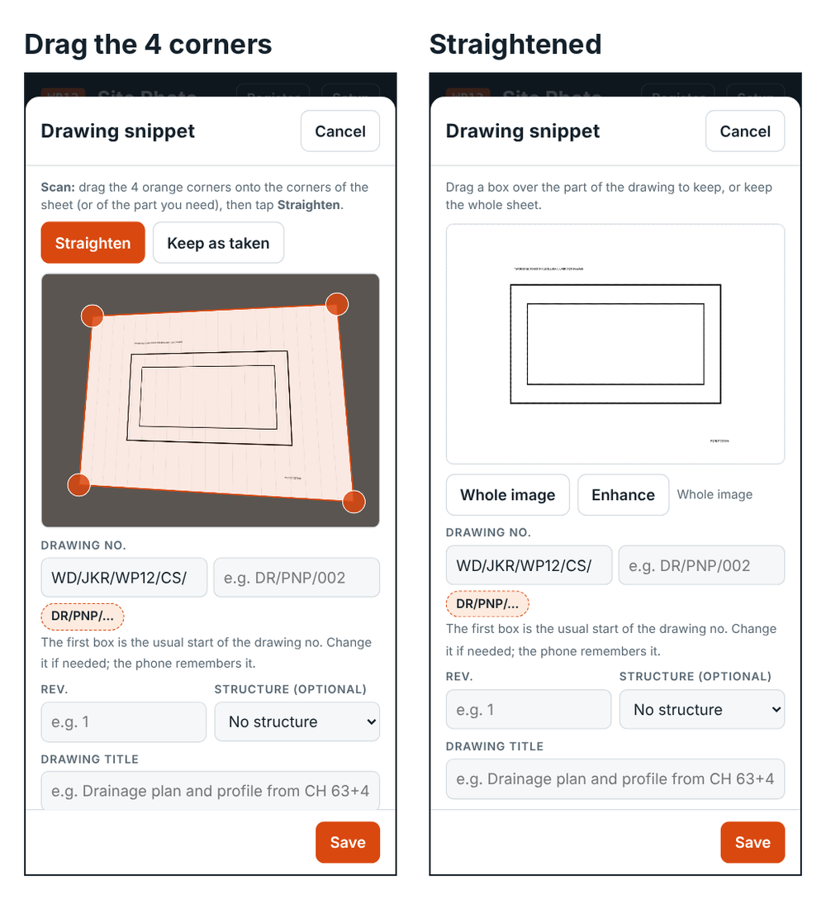

**In the PDF report and the RFI photo record**, the caption of each photo reads *Drawing: D1 WD/JKR/WP12/CS/DR/PNP/002*, and the snippets are printed on **Drawing reference** pages at the end, each with its drawing no., rev., title, what it shows and the photo numbers that refer to it.

Good practice:

- Use a PDF drawing where you can; it gives the sharpest print. For a screenshot, zoom in on the drawing first.
- Keep the snippet to the part the photo shows: the drawing references go wherever the PDF is shared.
- Snippets are for reference: the current issue of each drawing governs. Note the rev. so the reader can check it.
- Setup → *Experimental features* → **Drawings and references** to edit or delete them, or to hide the feature.

### Other references: memos, specifications, letters

The same library holds documents too. In step 4, choose the **Type**: *Drawing*, *Specification*, *Memo*, *Letter*, *Method statement* or *Other*. For a document, type its reference no. as written (e.g. *PYK/WP12/MEMO/045*), its title or subject, and its date or revision. Box the paragraph or table that matters, as for a drawing.

In the report and the RFI photo record, drawings are numbered D1, D2 …, and the other references by type: S1 for a specification, M1 for a memo, L1 for a letter, MS1 for a method statement. The caption reads e.g. *References: D1 WD/JKR/WP12/CS/DR/PNP/002; M1 Memo PYK/WP12/MEMO/045*, and the snippets print on the *References* pages.

## 6. RFI photo record

The RFI photo record is a PDF attachment to the JKR Sabah RFI form (Arahan Jabatan Bil. 11/2026): one record per RFI no. It shows what the photos show; the stage and inspection result stay on the signed RFI form, which remains the record of inspection.

Page 1 has:

- **details:** location (zone, chainage range, side), description of works, activities with their BQ / QC refs, structure and element, the number of photos and the report it came from;
- **photo index:** one line per photo with its no., time, activity, location, element and status;
- the **alignment diagram**, if ticked;
- **comments**, and sign-off blocks for **Prepared by (WPC)** and **Checked by (CST)**.

The photos follow from page 2, then the **drawing references** for that RFI's photos.

1. **Tag the inspection photos with the RFI no.** On each photo card, type the trade code and number in **RFI no.**, e.g. *EW-215*. Several photos can share one RFI no.
2. **Attach the drawing reference** to those photos (section 5).
3. **Tap Generate report.** When any photo has an RFI no., the report screen shows **RFI photo records** near the top. Tap **Make RFI photo records**.
4. **Open the RFI.** Each RFI no. has its own panel, with the location and description taken from its photos.
5. **Fill in if needed:** *Description of works* (leave it to use the activities, or type the RFI form's wording) and *Comments*.
6. **Check each photo's status** on the photo cards (e.g. *Ready for inspection*, *Inspected*); it is printed in the photo index.
7. **Preview**, then **Share** or **Save** the record (or **Save Word** to edit it first) and attach it to the RFI form.
8. **Sign on paper:** **Prepared by (WPC)** and **Checked by (CST)**.

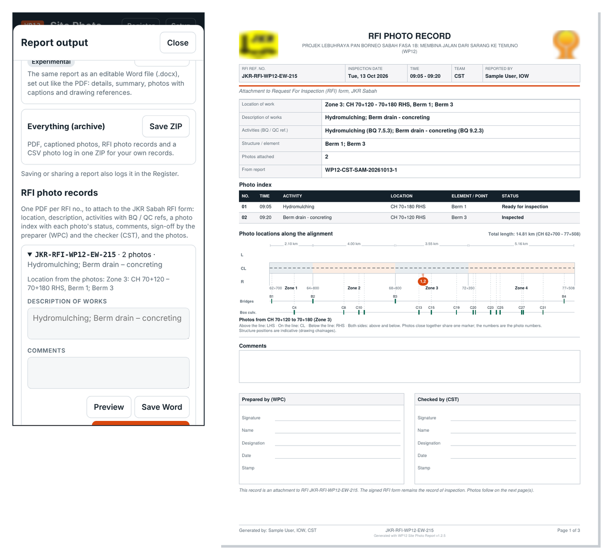

## 7. Register and backup

Every report you save or share is logged in the **Register** on your phone, so you can find past photos and RFIs without scrolling through WhatsApp.

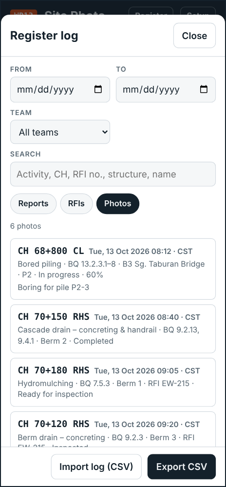

- **Views:** *Reports* (one line per report), *RFIs* (one line per RFI photo record, with the status of its photos) and *Photos* (one line per photo).
- **Filters:** date from and to, team, and a search box for activity, chainage, RFI no., structure or name.
- **Export CSV:** saves the current view as a CSV file that opens in Excel.
- **Import log (CSV):** adds another person's records. Use the `photo_log.csv` inside their ZIP.
- **Import PDF:** adds a PDF report made by the app (version 1.2.6 or later), e.g. one received on WhatsApp: every photo's details are inside the PDF. Save the PDF from WhatsApp first, then pick it here.
- **A scanned report record** (Scan, then the orange-framed QR code on page 1 of someone's report) adds a short line: report no., date, team, name, number of photos, chainages, activities and RFIs. Import the PDF for the photo details.

**Back up the register.** It lives only in this phone's browser; clearing the browser data deletes it. If you have not exported the register for 7 days the app shows a reminder: tap **Export now** to save the full photo log, or **Later**. Keep the exported CSV with your project files.

A team that wants one shared register can connect the app to its own Google Sheet (Setup → *Team register*); the steps are in [TEAM_REGISTER.md](TEAM_REGISTER.md).

## 8. RFI inspection list, request tickets and Today's RFIs (experimental)

The daily RFI summary list that WPC posts for the next day's inspections can be made in the app, in the same layout as the Excel list: No., RFI reference no., issued date, inspection date, description, location, PIC and time of inspection.

The **RFI inspection list** button is on the main screen, under Report details, when the team is **WPC**. The screen has three steps at the top: **1 RFIs** (dates and the RFIs), **2 Layout** (table, schedule or schedule in 2 columns, the line diagram, *Preview the PDF*, *Preview the board*) and **3 Share** (board, PDF, Word, text). *Requests* (late or extra inspections) is at the top of step 1, so it is seen first. **Colour by zone** (step 2) puts a coloured stripe and a legend by zone on the Schedule layouts and the board. Other teams can switch it on in Setup → *Experimental features*.

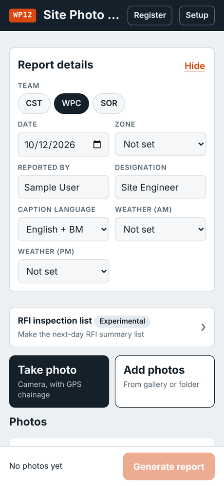

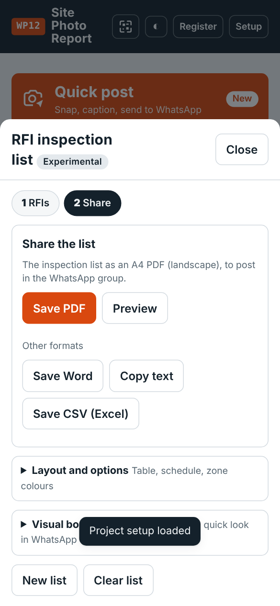

1. **Set the dates.** The *Inspection date* starts as tomorrow and the *Issued date* as today; change them if needed.
2. **Add the RFIs**, in either way:
   - **Paste from Excel:** in your Excel list, select the rows, with the heading row if you can, and copy. Tap **Paste from Excel**, paste in the box and check the table: the app matches the columns by their headings. A location written as a chainage, e.g. *Zone 4: CH76+500 - CH77+075 LHS*, goes into the chainage and side boxes; any other place, e.g. *Site Laboratory WP12*, stays as the other location. Tap **Add**.
   - **+ Add RFI:** type the RFI no. (the prefix *JKR-RFI-WP12-* is fixed), and optionally choose the activity: it fills in the description. Add the location, the PIC and the time. **Save and add another** keeps the form open.
3. **Check the list.** Use **Edit**, **↑ / ↓** and **×** on each row. **Sort: by time** or **by RFI no. (trade)**.
4. **List options** (at the top): choose the **PDF layout**: **Table (Excel layout)**, as WPC's Excel list, or **Schedule**: the RFIs in time order, grouped *Morning* and *Afternoon*, with the time in large type and a location strip for each RFI. Tick **Line diagram above the table** to show each RFI's location along the alignment, marked with its list no. and time of inspection (e.g. *01 · 9.30 AM*), and tick the **structure lines** to show (bridges, culverts, RS walls). RFIs elsewhere, such as the site laboratory, are listed under the diagram. Each RFI can also have **Remarks** (in the Add / Edit form), printed in their own column.
5. **Share the list:**
   - **Share board**: the list as a departures board in time order, up to 8 RFIs per page (a long list gives several pages, sent together), each page with an alignment strip down the right side marking every RFI's list no. at its chainage. The message with it has the list as text and a **link** that loads it in the app (*Today's RFIs*, below);
   - **Board PDF**: the same pages as one PDF document (stays sharp in WhatsApp; also for printing);
   - **Preview**, then **Share PDF** (A4 landscape, in the layout chosen above);
   - **Save Word** (or **Share Word**): the same list as an editable Word file;
   - **Copy text**: a short list to paste in the WhatsApp group;
   - **Save CSV (Excel)**.
6. **Next day:** tap **New list**. The last list is kept under **Earlier lists**.

A list shared again after a change (e.g. a late request added) gets a **revision no.** (*Rev. 1*, *Rev. 2* …) on the PDF and the board.

**The list travels inside the PDFs and the link**, not in QR codes: a phone camera cannot read a long list from a code, and WhatsApp shrinks images. The RFI list PDF and the board PDF both carry the whole list, so anyone with the app can load it from either.

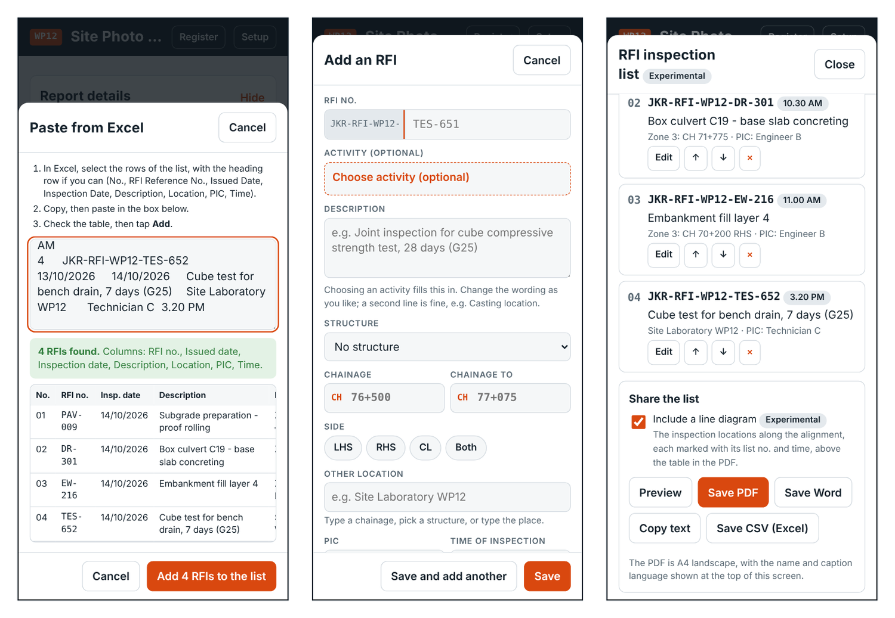

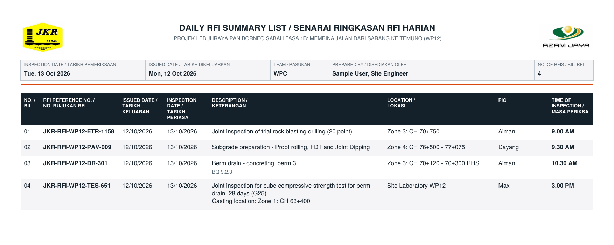

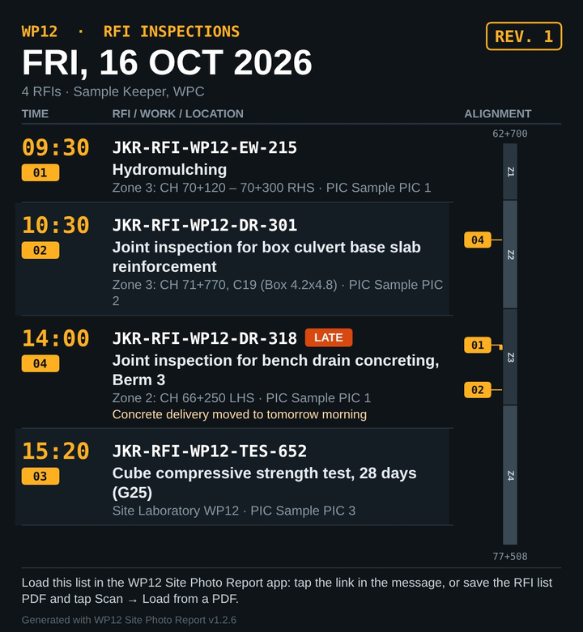 &nbsp; 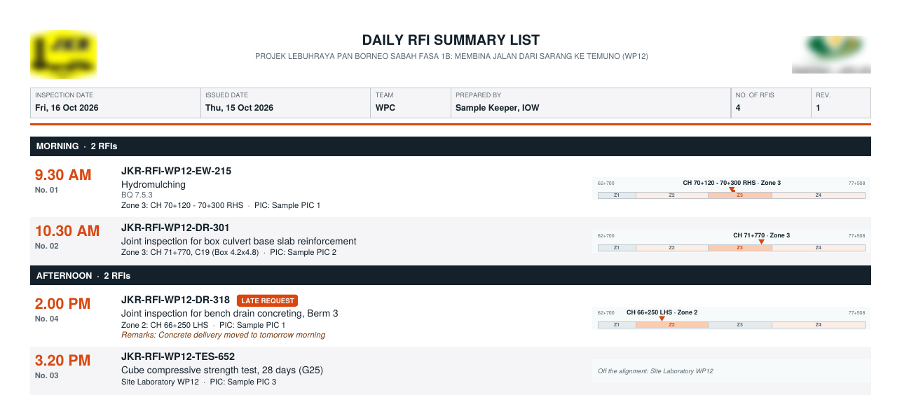

### Request an inspection: the RFI request ticket

Anyone at WPC who needs an inspection, e.g. after the list was posted, makes a ticket instead of a message:

1. **RFI inspection list → Request an inspection.** Fill in the RFI no. (leave it empty if it is not issued yet), the activity or description, the location, the **inspection date**, the time wanted, the PIC and the **remarks** (e.g. why it is late). Tap **Make ticket**.
2. **Share ticket**: the ticket image with a QR code goes to the group, with a message and a link.
3. **The person keeping the list** saves the image and taps **Scan → Scan from image** (or taps the link in the message, or scans the ticket on another phone's screen). The ticket opens with **Accept and add to the list** and **Decline**:
   - **Accept**: the RFI joins the list, marked *Late request*, with its remarks and the ticket no.;
   - **Decline**: type the reason (e.g. *No inspector free at 3 pm; choose a morning slot*).
4. Either way the app makes a **reply ticket** (green *Accepted* with the list no., or red *Declined* with the reason). Share it back; the requester scans it and the ticket under *My requests* shows the result.
5. **How you know it was approved**, under *My requests*:
   - **Accepted**: the reply ticket was scanned, **or** you loaded the next RFI list (link or PDF) and your ticket no. is on it: the official list is the proof;
   - **Not on the list for (date)**: a list for that day was loaded without your request;
   - **No reply yet**: 3 hours after sending, or on the inspection day. Tap **Remind** to share the ticket again.
6. A request still waiting can be **withdrawn** (tap **Withdraw** twice); tell the group too. Handled requests can be removed from the lists.

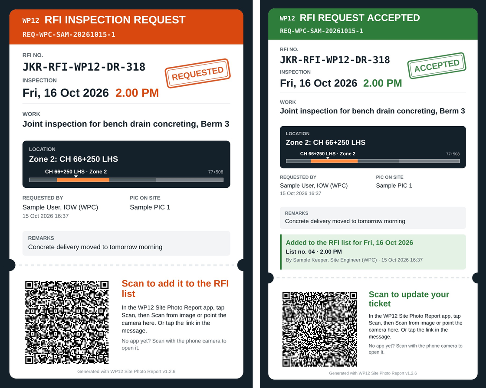

### Today's RFIs (inspectors)

Load the list in one of three ways, and the RFIs show on the main screen under **Today's RFIs**, in time order, with how long until each slot:

- **tap the link** in the list keeper's message;
- save the **RFI list PDF** or **board PDF** from WhatsApp, then tap **Scan → Load from a PDF** (or *Load a newer list (PDF)* on the panel);
- copy the whole message and paste it in **Scan → Paste the message or link instead**.

Loading a newer list replaces it.

- **Start record:** the camera opens; the photos you take get the RFI no., activity, structure and chainage from the list. Set the status, then *Generate report* → *RFI photo records*.
- An RFI shows **Inspected** once a photo with its RFI no. has the status *Inspected* (or *Re-inspection* / *Rectification required*), or when you tap **Inspected**.
- **Hide** takes the panel away until you load the next list.

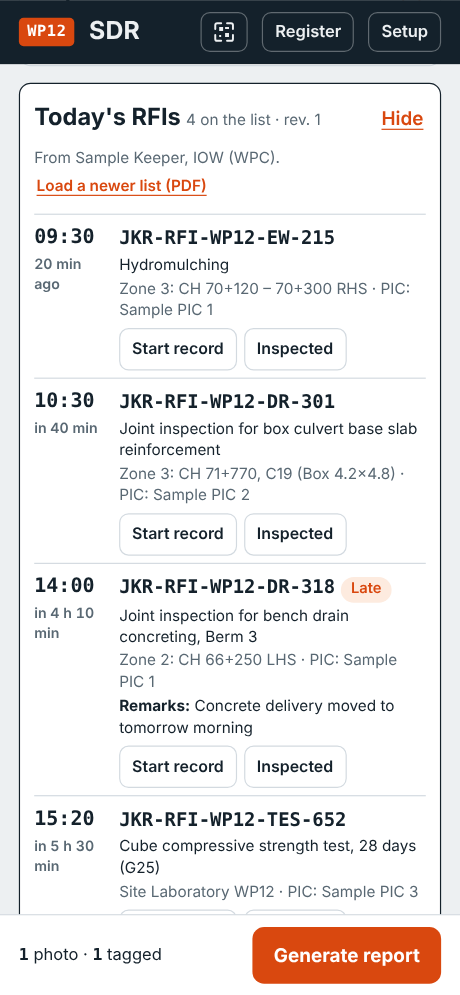

**On the inspection day**, typing an RFI no. on a photo card suggests the RFIs in the list. When the photo has no activity, structure or chainage yet, it takes them from the list (check them against the photo). The RFI photo record uses the list's description unless you type another one.

## 9. QR codes: scan and share

The **Scan** button (top of the screen, beside Register) reads the QR codes the app makes, and loads PDFs made by the app. Nothing goes to a server: the information is in the code, the link after *#*, or the PDF itself. QR codes only carry short things; a long RFI list travels in the PDF and the link (section 8).

| QR code | Where it comes from | What scanning it does |
| --- | --- | --- |
| RFI request ticket | A late request shared in the group | Opens it with *Accept* / *Decline* (section 8) |
| Reply ticket | The list keeper's reply | Updates your ticket under *My requests* |
| Report record | Page 1 of a PDF report (orange frame) | Adds the report to your Register (section 7) |
| Get the app | Page 1 of a PDF report, Setup → *Share this app* | Opens the app (any phone camera) |

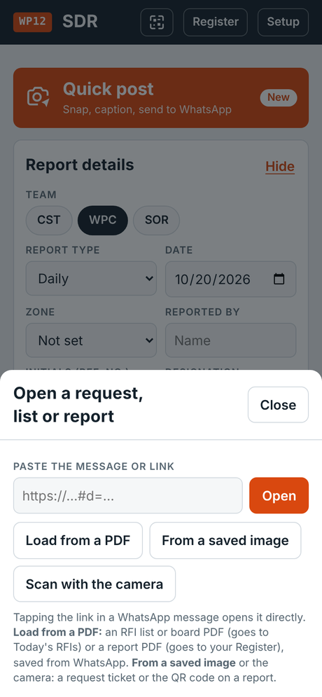

- **Scan with the camera:** tap the button, then point it at the code on paper or on another phone's screen. Allow the camera when asked.
- **From a saved image:** for a code received on this phone, e.g. a ticket image in WhatsApp: save the image, then pick it here. Use the image as received, not cropped.
- **Load from a PDF:** an RFI list or board PDF goes to *Today's RFIs*; a report PDF goes to your Register.
- **Links:** tapping the link in the message opens the app at the same place. On an iPhone with the app on the Home Screen, the link may open in Safari instead; then use *Scan from image*.

## 10. Experimental features

Experimental features are working, but still being tried during the pilot. Tell us at the pilot review whether to keep, change or remove them.

| Feature | Where | Default |
| --- | --- | --- |
| Drawings and references | Photo card → *+ Drawing / ref.*; Setup → *Experimental features* | Shown |
| Alignment diagram and structure lines | Report screen → *Include alignment diagram* | Off |
| Period report (week or month) | Report details → *Report type* | Daily |
| Word document (report, RFI photo record, RFI list) | *Save Word* / *Share Word* buttons | – |
| Scan a document or page | Setup → *Experimental features* → *Show Scan a document*; then a button beside *Take photo* and a tile in Quick post | Off |
| RFI inspection list | Main screen for WPC; Setup → *Experimental features* | WPC only |
| RFI list line diagram and structure lines | RFI inspection list → *List options* | Off |
| RFI request tickets, board, Schedule layout and Today's RFIs | RFI inspection list; main screen after loading a list | Table layout |

**Scan a document or page (experimental).** For a letter, a method statement or a page of a drawing book that belongs with the photos:

1. Switch it on in Setup → *Experimental features*. A button *Scan a document or page* appears under *Take photo*, and Quick post gets a *Scan page* tile.
2. Take a photo of the page, as flat and square-on as you can, with the whole page in view.
3. Drag the four round handles onto the corners of the page.
4. Choose *Black and white* (like a scan) or *Keep colour*, then tap **Use scan**. *Use the whole photo* adds the photo as taken.
5. The page is added as a photo with the tag *Scanned page*. Tag it like any other photo. It prints in the report like a photo.

The corners are placed by hand. Finding them automatically is planned for v1.3.

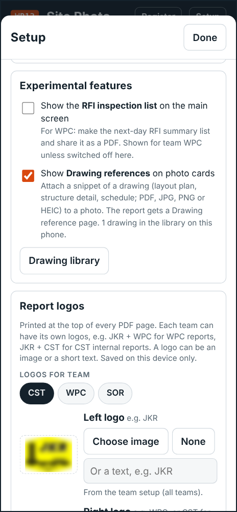

## 11. Updates, feedback and common problems

**Updates** arrive by themselves: open the app with signal and it loads the newest version. After an update, a short notice on the main screen says what changed; tap **See what changed** for the full list, then **OK**. The version number is at the bottom of **Setup**, and Setup → **What changed** opens the list of changes ([CHANGELOG.md](CHANGELOG.md)) at any time.

**Share the app:** Setup → **Share this app** shows a QR code: a colleague scans it with the phone camera to open the app, then adds it to the Home Screen. **Share link** sends the address in WhatsApp.

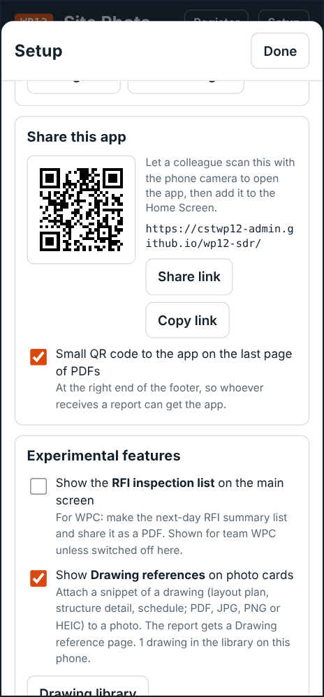

**Feedback:** Setup → **Send feedback on WhatsApp** opens a message with the app version and your phone type already filled in. Add what you tried to do, what happened and a screenshot, then post it in the WP12 RFI coordination group.

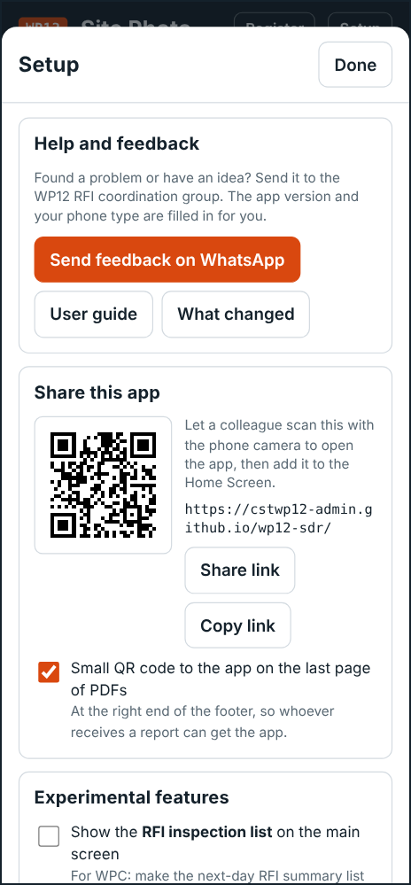

| Problem | What to do |
| --- | --- |
| No chainage filled in | The photo has no location: it was saved from WhatsApp, or location was off. Type the chainage, or add the original camera photo. On the phone, allow location for the camera and the browser. |
| Orange tag: GPS outside WP12 | The position is more than 150 m from the road. Check the photo and type the chainage, or tap *Elsewhere* for a lab or yard. |
| The activity is not in the list | Search in English, BM or by BQ no. first. Still missing: type it under *Not in the list?*, tap **Add**, and report it so it can be added for everyone. |
| Share opens nothing | If the bar at the bottom says *… is ready*, tap **Share** on it. Some browsers and laptops cannot share files: save the file, then send it from WhatsApp. On iPhone use Safari; on Android use Chrome. |
| Word file not found | It is in Downloads (Android, laptop) or Files → Downloads (iPhone). Tap **Save again** in the bar at the bottom if nothing appeared. |
| Two reports with the same ref. no. | From version 1.2.5 each report gets its own no. on the same phone. For an older report, type the right no. in the ref. no. box and share it again. |
| The drawing PDF does not open | The PDF viewer downloads the first time: open it once with signal. Or take a screenshot of the drawing and add that. |
| Setup still shows the old version | Open the app with signal, close it fully and open it again. |
| Logos or activity list missing | Open the app with signal so the project setup loads. |
| Photos or register gone | Browser data was cleared. Drafts and the register cannot be recovered; this is why the register should be exported regularly (section 7). |

---

The pilot and rollout plan is in [ROADMAP.md](ROADMAP.md).
