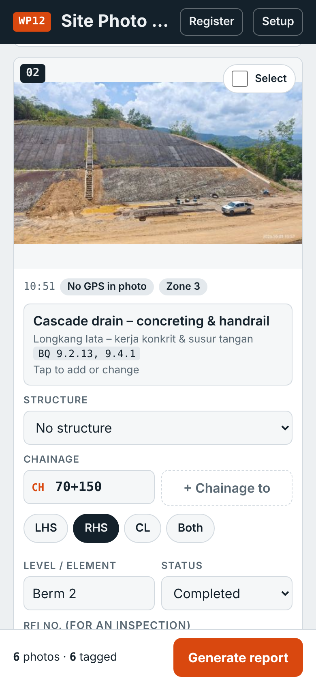
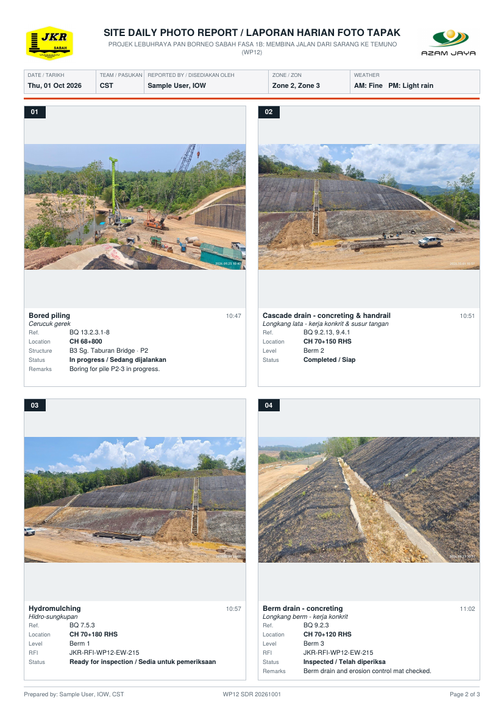
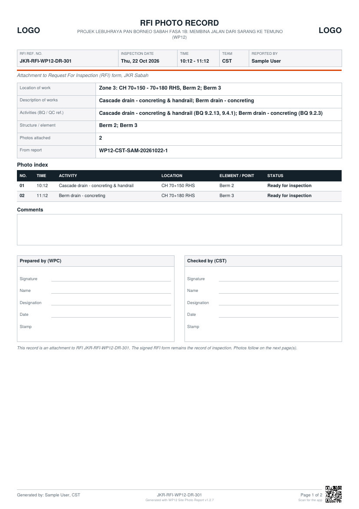

# WP12 Site Photo Report

A web app for recording site work with photos on **Projek Lebuhraya Pan Borneo Sabah Fasa 1B, Work Package 12 (Sarang – Temuno, CH 62+700 to 77+508)**.

Take or add the day's photos, tag each one with the activity (BQ item), chainage, structure and RFI number, then produce a captioned PDF report and photo set to share on WhatsApp and keep on record. It works on iPhone, Android and laptop, in the browser, with nothing to install from an app store.

**Open the app:** [cstwp12-admin.github.io/wp12-sdr](https://cstwp12-admin.github.io/wp12-sdr/) (also under **About** at the top right of this page). **New to the app?** Read the [user guide](GUIDE.md).

**News:** [From site photos to an RFI photo record: a worked example](posts/2026-10-22-rfi-photo-records.md) · [Effective daily reporting with the app (v1.2.5)](posts/2026-10-13-effective-daily-reporting.md) · [The pilot starts on 13 October](posts/2026-10-12-pilot-starts.md)

  
  &nbsp;
  

## What it is for

The app is a simple, consistent way to record:

- **site work progress**: what was done, where (chainage, side, structure) and under which BQ item;
- **inspections**: photos tied to the RFI number, with an RFI photo record for closing the RFI;
- **site observations**: ESCP, safety, traffic management, slope condition, weather and site condition;
- **site visits**: a dated, captioned photo record of what was seen.

It is meant for all three parties on the contract: the **Consultant Supervision Team (CST)**, the **Works Package Contractor (WPC)** and the **S.O. Representative (SOR)**. Each party uses the same app and keeps its own records and register.

It replaces forwarding loose photos to WhatsApp groups. Those photos are hard to caption one by one, lose their context when forwarded, and often can no longer be downloaded later.

## What it does

| | |
|---|---|
| **Activity list from the contract BQ** | 143 activities grouped by bill (earthworks, ground treatment, drainage, pavement, bridges, road furniture, ESCP, traffic, safety, QA testing & inspection, weather). Each shows its BQ item no., e.g. *Berm drain – concreting · BQ 9.2.3*. Bridge items show the BQ ref for the selected bridge. Search works in English or BM. |
| **QC tests required by the contract** | 50 quality control tests that are not BQ items: joint sampling, laboratory tests, FDT, coring, plate load, CBR, DCP, spray rate, gradation, cube tests (G20–G50, grout), rebound hammer, RC pipe, geotextile and PVD tests. They are marked **QC** in the list and in the report, e.g. *Cube test – G40 · QC*. |
| **More than one activity per photo** | A photo can be tagged with several activities, e.g. *Box culvert – concreting* + *Cube test – G30*. Tap each one in the list, then **Done**. |
| **Chainage from GPS** | Photos with a GPS position get their chainage and side (LHS/RHS) from the WP12 centreline, e.g. *CH 70+000, 20 m RHS*. Chainage can always be typed or adjusted by hand. For a stretch of work, tap **+ Chainage to** beside it, e.g. *CH 70+120 – 70+300*. |
| **Element / point** | The box on the photo card is named for the activity: *Sampling point* for monitoring and sampling (e.g. *W1*, printed as *Sampling point W1*), *Element* for bridges and culverts (e.g. *Abutment A*, *Pier 2*), *Layer / level* for earthworks and pavement (e.g. *Layer 3*, *Berm 2*). |
| **Elsewhere** | For photos taken away from the alignment, e.g. at the site laboratory, a third-party laboratory, a factory or precast yard: tap **Elsewhere** and type the place instead of a chainage. Places are remembered on the phone. |
| **Test result** | For testing and sampling activities: Passed, Failed, Retest required, Pending test result, Pending official test result, or your own wording. Prints with the status and goes into the register. |
| **Progress %** | An optional estimate on each photo, e.g. *Reinforcement installation, 20% complete*, for work followed over several days. |
| **Status** | Each photo can have a status: In progress, Completed, Ready for inspection, Inspected, Re-inspection required, Rectification required, Observation, or your own wording. It prints in English and BM. |
| **Structure list** | Bridges B1–B4, culverts C1–C32, junction culverts JC1–JC13 and the reinforced soil walls. Picking one fills in its drawing chainage, which you then adjust to the actual site position. |
| **Zones** | The team's zones load with the setup. A team that reports by other zones, e.g. 5 zones for CST, can set its own in **Setup → Zones**; a team setup update keeps them. |
| **Sort by time or chainage** | Photos are in the order taken; **Sort by chainage** puts them in order along the alignment instead, matching the diagram. |
| **Tag many photos at once** | Select several photos and apply the same activity, chainage, side, status, RFI no. or remarks in one step. **Same as previous** copies the tags and remarks from the photo above, but keeps a photo's own GPS chainage. |
| **PDF report** | A4, 2 photos per page (the default) or 4 per page, with logos for each team (an image or a text, e.g. JKR + WPC, or JKR + CST for internal reports), report details, weather, an optional summary table, and a caption under each photo. Captions in English, Bahasa Malaysia, or both. |
| **Captioned photos** | Each photo with the date, time, chainage, activity, BQ ref and RFI printed on it, renamed in order (e.g. `20261009_CST_03_CH71+770_Box-culvert-concreting.jpg`). The caption stays with the photo when it is forwarded. *Preview* shows them before sharing; the photo no. (off by default) and team on the first line can be switched on or off. |
| **Location strip** | A small line of the whole alignment on each photo, with its zone shaded and a marker at its chainage, under the caption (default) or across the top of the photo, in the PDF and on captioned photos. |
| **Share the app** | Setup shows a QR code of the app's address. Page 1 of every PDF report has a *Get the app* QR code (RFI records and the RFI list: at the end of the last page). |
| **Quick post** | The button at the top: pick photos from the gallery (or take one), tag them on one screen (GPS chainage, side, activity and structure drawers, status, remarks) and share it to WhatsApp. The caption goes below the photo as a table (the photo is not covered), on the photo, or as the message text with the photo as taken. Choose which parts the caption shows. The photos also go into the day's report. |
| **Save to phone** | Photos taken in the app keep their camera original; the app offers to save a copy to the phone (Android: Downloads; iPhone: share menu → Save Image), and Save ZIP can include the originals. |
| **Scan QR codes, load PDFs** | The *Scan* button reads QR codes with the camera or from a saved image (request tickets, report records) and loads PDFs made by the app (RFI lists, reports). Links in WhatsApp messages open the app at the same place. Nothing is sent to a server: the data is in the code, the link or the PDF itself. |
| **RFI request tickets (WPC)** | A late request for the RFI list is made as a ticket with a QR code and shared in the group. The person keeping the list scans it, accepts it (added to the list as a late request, with its remarks) or declines it with a reason, and shares the reply ticket back. |
| **Today's RFIs** | The RFI list (board pages with an alignment strip, or the PDF in Table or Schedule layout) carries the whole list in its PDF and in the link in the message. Inspectors load it: the RFIs show on their main screen in time order, with a countdown, *Start record* (photos tagged with the RFI no., activity, structure and chainage from the list) and *Inspected*. |
| **Report record** | Page 1 of the PDF report can carry a report record QR code (orange frame, off by default; Setup switches it on): another phone with the app scans it into its Register. **Register → Import PDF** reads every photo's details from a PDF report itself, e.g. one received on WhatsApp. |
| **Sections line (CST)** | CST-S1 to CST-S5 under the location strip, with *CST structures* for photos at a structure. On for team CST; other teams can switch it on in Setup. |
| **RFI photo record** | One PDF per RFI no., set out to accompany the JKR Sabah *Request For Inspection* form (Arahan Jabatan Bil. 11/2026). It is an attachment, so it carries what the photos show: location, description, activities with their BQ / QC refs, structure and level, a photo index with each photo's status, comments, sign-off blocks for **Prepared by (WPC)** and **Checked by (CST)**, and the photos. The drawing reference, stage and result stay on the signed RFI form. |
| **Alignment diagram (experimental)** | An optional line from CH 62+700 to 77+508 with the zones, showing where each photo was taken, with the length of each zone and the total length: above the line for LHS, on it for CL, below it for RHS. Photos close together share one marker, and a line under it gives the chainage range covered. Optional structure lines under it show the bridges, pipe culverts, box culverts, junction culverts and RS walls, each ticked on its own. Tick it on the report screen; it is added to page 1 of the daily report and of each RFI photo record. |
| **Report ref. no.** | Every report gets a reference, e.g. *WP12-WPC-SYA-20261012-1*: package, team, the reporter's initials, date and the report no. of the day on that phone. It prints on the PDF, the WhatsApp text, the RFI photo record, the file names and the register, so a report is easy to find and cross-reference. Each report on a phone gets its own no.: *New report*, or changing the photos of a sent report, gives the next no. |
| **Check before you share** | Before you share, the app lists photos with no activity or no location. Tap a photo number to go straight to it. |
| **WhatsApp message** | A short list of activities and chainages to paste with the PDF. |
| **Drawings and references (experimental)** | Attach a snippet of a drawing (layout plan, structure detail, schedule), or of a memo, specification, letter or method statement, to a photo. Snippets are kept in a drawing library on the phone, suggested for photos at the same structure or chainage, named in the photo caption (*Drawing: D1 WD/JKR/WP12/…*) and printed on Drawing reference pages at the end of the report and the RFI photo record. |
| **Scan a document (experimental, on by default)** | Photograph a page; the app finds its corners, straightens it into a flat page, with a clean, grey, black-and-white or original look and brightness / contrast sliders, and shows a preview before it is added as a photo marked *Scanned page*. The button sits beside *Take photo* and in Quick post; Setup → Experimental features switches it off. |
| **Preview and Word** | *Preview* shows the PDF in the app before sharing. *Save Word* (experimental) saves the same report, RFI photo record or RFI inspection list as an editable Word file set out like the PDF. |
| **Period report (experimental)** | Report type *Period* keeps collecting photos over several days, then makes one report for the week or month: a progress table (latest status and progress for each activity and place), then the photos day by day. |
| **RFI inspection list (experimental, for WPC)** | The daily RFI summary list for the next day's inspections: paste the rows from Excel or add RFIs one by one (with the activity list, chainage, structure, PIC and time), then share it as an A4 PDF in the same layout as the Excel list, as WhatsApp text or as a CSV. On the inspection day, RFI nos. typed on photo cards are suggested from the list, and the RFI photo record takes its description. |
| **Register log** | Every report saved or shared is logged on the device, with Reports, RFIs and Photos views, filters and CSV export (opens in Excel). Logs from other users can be imported. |
| **Works offline** | Once opened, it works without signal on site. Drafts are kept if the phone closes the browser. The app asks the browser to keep its data, and reminds you to export the register if it has not been exported for 7 days. |
| **Feedback** | Setup → **Send feedback on WhatsApp** opens a message with the app version and phone type filled in, ready to post in the RFI coordination group. |

## Getting started

1. Open [cstwp12-admin.github.io/wp12-sdr](https://cstwp12-admin.github.io/wp12-sdr/) on your phone.
2. Add it to the home screen:
   - **iPhone (Safari):** Share → *Add to Home Screen*
   - **Android (Chrome):** menu ⋮ → *Install app* or *Add to home screen*
3. Open it from the home screen icon. The project setup (logos, zones, activity list, structures and centreline) loads by itself.
4. In **Report details**, choose your team (CST, WPC or SOR) and enter your name and designation. These are remembered.
5. Allow location when the camera asks, so photos taken in the app get their chainage. Photos saved from WhatsApp have no location, so add the original camera photos when you want the chainage filled in.

## Daily use

1. **Take photo** at site, or **Add photos** from the gallery afterwards.
2. For each photo, or for several selected together, choose the **activity** (one or more) and check the **chainage** and **side** (tap **+ Chainage to** for a stretch of work). Add the level or element (e.g. *Berm 3*, *Layer 2*, *P2*), structure, status, RFI no. and remarks where needed.
3. Tap **Generate report**, check the list of photos still missing an activity or chainage, choose 2 or 4 photos per page and, if wanted, the alignment diagram, then:
   - **Save PDF** or **Share PDF** (pick WhatsApp and the group);
   - **Share photos**: the captioned photos;
   - **Copy text**: the WhatsApp summary;
   - **Make RFI photo records**: one per RFI, to attach to the RFI form (shown at the top when any photo has an RFI no.);
   - **Save ZIP**: everything, plus a CSV photo log, for your own files.
4. Start the next day with **New report** (below the last photo).

RFI numbers use the fixed prefix `JKR-RFI-WP12-`, so only the trade code and number are typed, e.g. `TES-651`.

## Records and data

- **There is no server and no login.** Photos, reports and the register stay on the phone or laptop that made them. Nothing is uploaded to this site.
- Each party keeps its own records: the PDF and ZIP files it saves, and the **Register** in the app. Export the register to CSV regularly and keep it with your project files. Clearing the browser's data removes it from the device.
- To combine records, import other users' `photo_log.csv` (inside their ZIP) under **Register → Import log**.
- A team that wants one shared register can connect the app to its own Google Sheet (Setup → *Team register*). The guide is in [TEAM_REGISTER.md](TEAM_REGISTER.md) and the script is [Code.gs](Code.gs). It is optional, and the sheet belongs to that team.
- This repository is public. It holds only the app, the logos, the activity list (BQ item numbers, no rates), structure chainages and the road centreline.

## Accuracy notes

- Phone GPS is typically accurate to about 5–10 m, so GPS chainage is rounded to the nearest 5 m. Check it against site pegs where it matters.
- The centreline is the tender alignment from the project KMZ. Structure chainages are taken from the drawings and BQ and are **indicative only**.
- The app produces photo records. It does not replace the contract documents, the signed RFI form or formal correspondence.

## Updating the setup

The file `setup.json` holds the project setup for everyone: logos, project title, zones, activity list, structures and centreline.

1. In the app, make the change in **Setup** (for example *Add an activity*), then tap **Save setup file**. It saves as `setup.json`.
2. In this repository: **Add file → Upload files**, drop in the new `setup.json`, then **Commit changes**.
3. Phones pick it up the next time the app is opened with signal.

A new version of the app (`index.html`) is updated the same way.

## Using it on other work packages

The app is built so the project data is separate from the app itself. For another work package, make a copy of this repository (e.g. `wp13-sdr`) and replace `setup.json` with that package's:

- project title, contract no. and RFI prefix;
- chainage limits and zones;
- activity list, prepared from that package's BQ;
- structure list (bridges, culverts and so on), from its drawings;
- road centreline with chainages, from the alignment KMZ or setting-out data;
- client and contractor logos.

## User guide, version history and roadmap

Step-by-step instructions with screenshots are in [GUIDE.md](GUIDE.md); in the app, Setup → **User guide** opens it. The current version is shown in the app under **Setup** (bottom panel). Changes are listed in [CHANGELOG.md](CHANGELOG.md); in the app, Setup → **What changed** opens it. The pilot and rollout plan and the features under consideration are in [ROADMAP.md](ROADMAP.md).

## Files

| File | What it is |
|---|---|
| `index.html` | The app, built from `src/` by `tools/build.py` (not edited by hand) |
| `setup.json` | Project setup: logos, zones, activities, structures, centreline |
| `manifest.webmanifest`, `sw.js`, `icon-192.png`, `icon-512.png` | Let the app install on a phone and work offline |
| `heic2any.min.js` | Converts HEIC / HEIF photos (loaded only when one is added) |
| `pdfjs.min.js`, `pdfjs.worker.min.js` | Opens PDF drawings for drawing references (loaded only when one is added) |
| `GUIDE.md`, `guide/` | User guide and its screenshots |
| `posts/` | News posts, e.g. the pilot announcement |
| `CHANGELOG.md` | Revision history |
| `ROADMAP.md` | Pilot and rollout plan, future features |
| `TEAM_REGISTER.md`, `Code.gs` | Optional: guide and script for a team register in Google Sheets |
| `screenshot-*.png` | Pictures used on this page |
| `src/` | The app's source: code in `src/js/`, page template `src/app.html`, project data in `src/config/` |
| `tools/` | `build.py` builds the app from `src/`; `make_setup.py` refreshes `setup.json` |
| `tests/` | Automatic checks of the app (`test_app.py`) with sample photos |
| `CLAUDE.md`, `DEVELOPING.md` | How changes are made, checked and published |

## Ringkasan (BM)

Aplikasi web untuk merekod kerja tapak, pemeriksaan, pemerhatian dan lawatan tapak WP12 menggunakan foto. Setiap foto ditanda dengan aktiviti (item BQ), rantaian (chainage), struktur dan no. RFI. Aplikasi kemudian menghasilkan laporan PDF (4 foto setiap muka surat), foto berkapsyen, rekod foto RFI dan log daftar. Ia boleh digunakan oleh CST, WPC dan SOR pada iPhone, Android dan komputer riba. Semua data disimpan dalam peranti pengguna sendiri.

---

Developed for the WP12 Consultant Supervision Team. Maintained by WPN.
