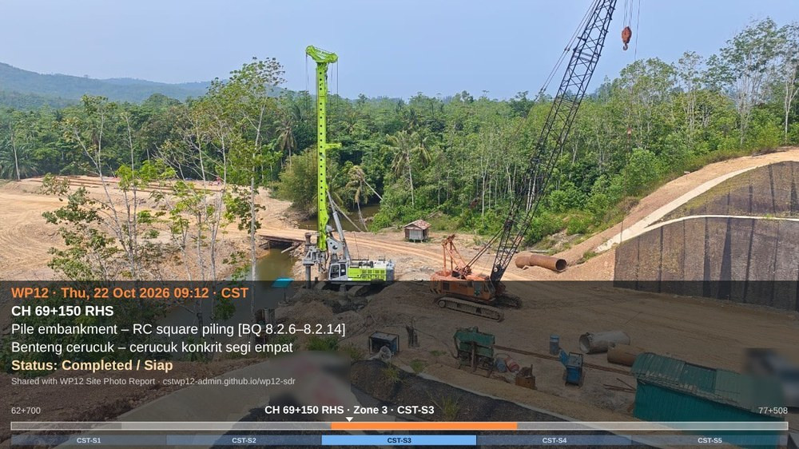
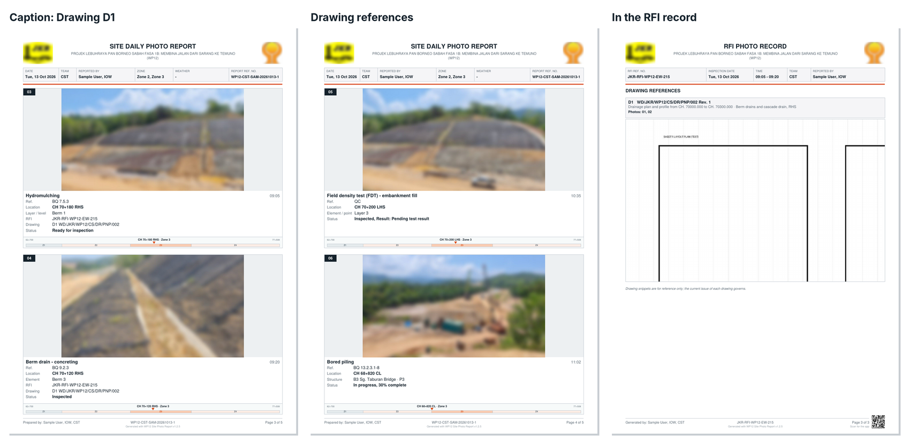

# Effective daily reporting with the WP12 Site Photo Report

*13 October 2026 · WPN*

The first day of the pilot went well: reports came in as PDFs instead of loose photos. Looking through them, most used only the basics, an activity and a chainage. Many skipped the status, the test result, the RFI no. and the time savers that are already in the app. A few people also sent several reports on the same day with the same report no.

Version 1.2.5 fixes the numbering and adds a few things, listed at the end. This post is about getting the most out of what is already there, so that each report answers the reader's questions before they are asked.

## What the reader wants to know

Whoever opens your report, whether the S.O. Representative, the CST or the contractor's office, looks for the same five things. Each has a place in the app, and each prints in the caption.

| The reader asks | Fill in | Prints as |
| --- | --- | --- |
| What was done? | **Activity** (from the BQ or a QC test), **element or level** | *Berm drain – concreting [BQ 9.2.3]*, *Berm 3* |
| Where exactly? | **Chainage** (from GPS), **side**, **structure**, or **Elsewhere** for a lab or yard | *CH 70+120 RHS*, *B3 Sg. Taburan Bridge*, the location strip |
| How far along is it? | **Status**, **progress %**, **test result** | *In progress, 60% complete*; *Inspected, Result: Pending test result* |
| What was it checked against? | **RFI no.**, **drawing reference** | *JKR-RFI-WP12-EW-215*, *Drawing: D1 WD/JKR/WP12/CS/DR/PNP/002* |
| What is still open? | **Status** and **remarks** | *Rectification required*, *Erosion at lower slope face* |

A photo with only an activity and a chainage answers the first two. The other three take a few taps, and they are what turns a set of photos into a record someone can act on.

## Before going to site

- Open the app once with signal: it updates itself and loads the latest project setup.
- In **Report details**, check your **team**, **name**, **designation** and **initials** (the initials go into the report no.), and the **caption language**.
- If yesterday's report was shared, tap **New report** (twice) to start clean.

## On site

- **Use Take photo in the app, or the phone camera's own photos.** The GPS then fills in the chainage and side. Photos saved from WhatsApp have lost their location and their date.
- **Tag as you go, or at the end of the day.** The first photo of a series takes a minute; **Same as previous** copies its tags to the next one, and **Tag selected** sets the same tags on several photos at once.
- **For a stretch of work**, tap **+ Chainage to** and give the end chainage, e.g. *70+120* to *70+300*.
- **For the site laboratory, a precast yard or another site**, tap **Elsewhere** and type the place. A chainage there would be wrong.

## Tagging well

- **Status on every photo.** In progress, Completed, Ready for inspection, Inspected, Re-inspection required, Rectification required or Observation. It is the first thing a reader looks for.
- **Test result on every test.** Passed, Failed, Retest required, Pending test result or Pending official test result. A cube test inspected today with its result due in 7 days is *Inspected, Result: Pending test result*.
- **Progress % for work followed over several days**, e.g. reinforcement fixing at *60% complete*.
- **Element or level**: *Pier 2*, *Berm 3*, *Layer 3*, *Sampling point W1*. The chainage says where; the element says what.
- **RFI no. on inspection photos**, and the **drawing reference** they were checked against. The RFI photo record then carries the photos, the location and the drawing, ready to attach to the RFI form.

## Drawing references for RFI photo records

This is the largest addition in 1.2.5, and still experimental. On a photo card, tap **+ Drawing ref**, add the drawing from a PDF, an image or a camera scan of a paper drawing, and drag a box over the part that matters. Type the rest of the drawing no. (the usual start *WD/JKR/WP12/CS/* is filled in), the rev. and the title. The drawing is kept on your phone and suggested on other photos at the same structure or chainage.

In the PDF report and the RFI photo record, each photo's caption names the drawing, and the snippets print on **Drawing reference** pages at the end. The inspection evidence and the drawing it was checked against then travel together. The step-by-step guide with screenshots is in section 5 of the [user guide](../GUIDE.md).

## Before you share

1. **Read *Check before you share*.** It lists photos with no activity or location; tap a photo number to fix it.
2. **Choose the layout.** 2 photos per page is now the default; 4 per page makes a shorter report. The location strip under each caption shows where the photo sits on the 14.81 km alignment.
3. **Tap Preview.** Look through the pages as the reader will see them.
4. **Share PDF** to the group. For inspections, also share each **RFI photo record**.

## One report or several a day

One report a day is simplest. Several are fine, for example one for bored piling and one for safety observations, if each is its own report. From 1.2.5 the app makes sure of that: **New report** always gives the next report no., and changing the photos of a report that was already sent makes the next one a new report with its own no. and its own line in the Register.

## After you share

- Every report you share or save is logged in the **Register** on your phone. Search it by chainage, RFI no. or activity instead of scrolling through WhatsApp.
- The Register lives only on your phone. **Export it every week** (Register → Export CSV) and keep the file with your project records.
- **Save ZIP** keeps the PDF, captioned photos, RFI records and a photo log together for your own files.

## Features people skip

| Feature | Where | What it saves |
| --- | --- | --- |
| Same as previous | Each photo card, from photo 2 | Retyping the same tags along a series |
| Tag selected | Select photos → Tag selected | Tagging many photos one by one |
| Sort by chainage | Above the photo list | Reordering by hand |
| Elsewhere | Photo card, under the element | A wrong chainage on lab or yard photos |
| Test result and progress | Photo card, beside the status | A separate follow-up list |
| Preview | Report screen | Re-sending a report with a mistake |
| Drawing suggestions | Photo card, Drawing refs | Picking the same drawing again |
| Register search and export | Register | Scrolling through chats to find an old photo |

## New in version 1.2.5

- **2 photos per page** as the default, with the page count shown for each choice.
- **Location strip** under each caption: the whole alignment, the photo's zone and a marker at its chainage.
- **Drawing references** (experimental) for the report and the RFI photo record.
- **Preview** before sharing the report, RFI photo records, the RFI list and the captioned photos.
- **Word documents** (experimental): save or share the report, an RFI photo record or the RFI list as an editable .docx.
- **One report, one number**: each report on a phone gets its own no.
- **Share the app by QR code** from Setup, and a small QR code on the last page of every PDF.
- The CST logo for team CST, zone lengths on the alignment diagram, an RFI list line diagram (experimental), and duplicate photos skipped.

The full list is in the [change log](../CHANGELOG.md), and the [user guide](../GUIDE.md) has been updated with new screenshots. Open the app with signal and it updates itself.

## Feedback

If something does not work the way you expect, use **Setup → Send feedback on WhatsApp**: it fills in the app version and your phone type. The pilot review on 27 October will decide which of the experimental features stay. Tell us what you use, what you skip, and why.
